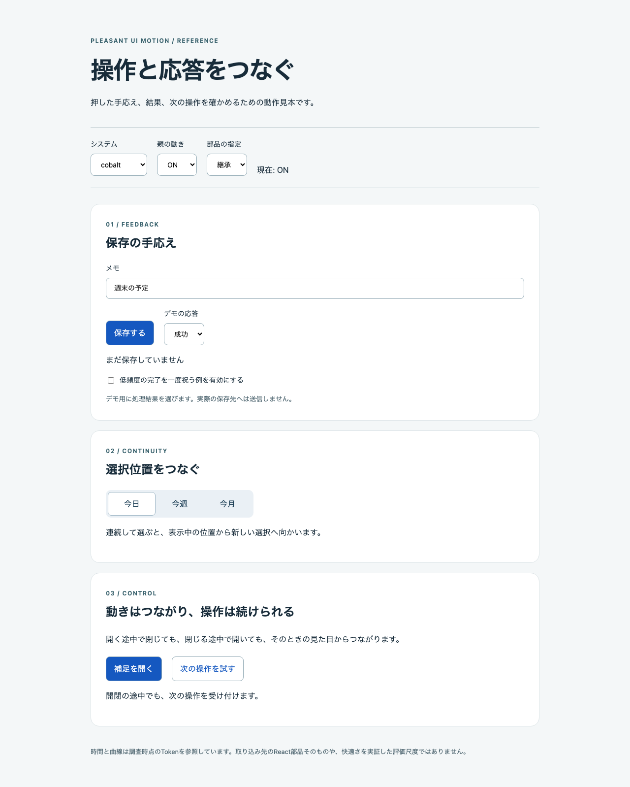

# 気持ち良いUIモーションを既存デザインシステムへ取り入れる

ボタンを押したとき、人は「入力が届いたか」「何が変わったか」「結果はどうなったか」「次に何ができるか」を知りたいと考えられます。動きが滑らかでも、保存前に成功を祝ったり、閉じる操作を受け付けなかったりすれば、このつながりは崩れます。

このパターンでは、**ユーザーの意図とUIの応答が自然につながり、操作の理解と手応えを高める動き**を「気持ち良いUIモーション」と定義します。即応性・連続性・意図との一致・自然な運動・操作の主導権を基本品質とし、その上に遊び心を加えます。6分類と「予測と結果の一致」という説明は、ガイドラインを統合した設計上の解釈です。心理学的に確立された単一の公式や、検証済みの採点尺度ではありません。

配布物は、この判断を実装用・レビュー用スキル、機械で確認できる適用仕様、操作できる参照実装にまとめたものです。参考にする取り込み先は[Yukihito Design System](https://github.com/yukihito-jokyu/design-system)。既にあるnew-york／cobaltの部品・共通値・Motion機構へ接続します。

## 全体像

```text
pleasant-ui-motion/
  .claude/skills/
    pleasant-ui-motion/             実装スキル、参照資料、CLI、profile
    pleasant-ui-motion-review/      対応するレビュー
  motions/<id>/
    motion.json                     作者が編集する適用仕様
    motion.css                      既存Tokenへの参照（生成）
    motion.md                       状態と途中操作の方針（生成）
  examples/                         操作できる最小の動作見本
  tools/                            全検査、配布CI、対象API照合
  tests/                            仕様と参照UIの検証
  docs/design/                      ルール、調査、構造、判断、収束結果
  .foundation/                      ルール対応検査、違反probe、収束記録
```

スキルは、まず取り込み先の既存ルールと実装を読みます。次に操作の目的・状態・頻度を仕様へ書き、対象システムのTokenへ対応付けます。その結果を参考に実UIへ接続し、そこでの操作を確認します。

`motion.css`はアニメーションを実装するファイルではありません。`motion.md`も適用計画です。両方を生成しただけでは、React部品の変更や利用アプリの検証は完了しません。これにより、仕様の整合と実際の使い心地を分けて判断できます。

## 「気持ち良い」を判断できる条件にする

Appleは目的のある短いフィードバックとキャンセル、Materialは関係・意図・一貫性を重視しています。このパターンでは、それらを次の観点へ整理します。[Apple Motion](https://developer.apple.com/design/human-interface-guidelines/motion)、[Material 1 Motion](https://m1.material.io/motion/material-motion.html)

| 観点 | 実際に確かめること | 実装での判断 |
|---|---|---|
| 即応性 | 押した直後に受理を知覚できるか | 開始を通信や演出の終了まで遅らせない |
| 連続性 | 同じ対象、移動先、因果を追えるか | 選択面は表示中の位置から新しい目標へ |
| 意図との一致 | 操作目的に対する状態・結果が分かるか | 保存中・失敗・再試行・成功を実処理から伝える |
| 自然な運動 | 距離・方向・速度・停止に納得できるか | 既存Tokenを使い、意味のない移動を足さない |
| 操作の主導権 | 次の操作や中断が妨げられないか | 動きを保ち、逆操作・別操作・フォーカスを演出完了に依存させない |
| 遊び心 | 反復しても意味や可読性を妨げないか | 低頻度の確定済み成功へ一度だけ加える |

動きを減らす設定、キーボード操作、動き以外の状態通知は、全観点に関係する前提です。基本品質の未達を、遊び心の点数で帳消しにしません。W3CのSC 2.3.3は非本質的な操作起因の動きを止められることを扱います。この対応だけでWCAG全体への適合を宣言するものではありません。[W3C SC 2.3.3](https://www.w3.org/WAI/WCAG22/Understanding/animation-from-interactions.html)

### 時間は目安と既存値を分ける

NN/gは一般論として100〜500ms、多くの場合100〜400msと説明しています。Microsoftの「開始を50ms以内に」という記述はWindows 7向け資料の目安です。どちらも、全てのWeb UIへ機械的に適用する規格にはしません。[NN/g](https://www.nngroup.com/articles/animation-duration/)、[Microsoft](https://learn.microsoft.com/en-us/windows/win32/uxguide/vis-animations)

押下80〜150ms、hover/toggle100〜200ms、出現150〜250ms、モーダル200〜300ms、拡大・遷移250〜400ms、祝福200〜400msという範囲は、今回の依頼で示された独自の初期値です。既存デザインシステムへ取り込む際は、既存Tokenを優先し、これらの範囲へ無断で変更しません。

また、現行Material 3はばね方式へ移行しています。ばねの速度・減衰と固定時間のCSS曲線は別の設計です。Cobaltの`--cobalt-ease-spring`も、名前にspringを含むcubic-bezierであり、物理シミュレーションではありません。[Material 3 Motion physics](https://m3.material.io/styles/motion/overview/how-it-works)

## 仕様の項目と具体的な動作

`motions/save-preferences/motion.json`は、保存の目的と状態を次のように定義します。

```json
{
  "id": "save-preferences",
  "system": "cobalt",
  "recipe": "save",
  "intent": "設定の保存結果を伝える",
  "frequency": "frequent",
  "delight": false,
  "labels": {
    "idle": "保存する",
    "pending": "保存中",
    "success": "保存しました",
    "error": "保存できませんでした",
    "retry": "再試行"
  }
}
```

`id`は生成先の名前になり、ディレクトリと一致させます。`system`は一方のデザインシステムを選び、`recipe`が必要な状態とTokenの役割を決めます。`intent`は、その動きが何を助けるかをレビューするための説明です。`intent`が非空かは機械で確認できますが、意味が正しいかまでは判断できません。

`frequency`は`frequent`か`infrequent`です。`delight`の既定は`false`で、`true`にできるのは`infrequent`の`save`／`notify`だけに絞っています。これは、反復する日常操作に過剰な祝福を混ぜないための本パターンの初期方針です。

`labels`にはrecipeごとの全状態を、異なる非空の文字列で指定します。保存では`pending`を省略したり、成功と失敗を同じ文言にしたりすると検査で落ちます。文言が実処理と合うか、実UIで状態通知として伝わるかはレビューします。未定義キーを黙って無視しないため、`duration: 300`のような独自項目もエラーになります。

### recipeで状態と途中操作をそろえる

`.claude/skills/pleasant-ui-motion/assets/recipes.json`が状態と途中操作の対応を持ちます。保存の定義は次の形です。

```json
{
  "save": {
    "labels": ["idle", "pending", "success", "error", "retry"],
    "interruption": "state-first",
    "meaning": "処理結果を確認してから成功を示す",
    "relation": "same-control"
  }
}
```

`state-first`は、業務状態を先に更新し、演出をその状態へ従わせる方針です。保存のアニメーションが終了しても、処理が失敗していれば成功にはしません。

| recipe | 状態ラベル | 途中操作 | 伝える関係 |
|---|---|---|---|
| press | idle | latest | 同じ操作部品 |
| save | idle/pending/success/error/retry | state-first | 同じ操作部品 |
| selection | idle/selected | retarget | 同じ対象 |
| disclosure | open/close | reverse | 同じ対象 |
| reorder | idle/changed | latest | 一覧の順序 |
| step | previous/next | latest | 段階の順序 |
| notify | success | latest | 確定した結果 |
| navigation | from/to | latest | 無関係な画面間 |

`latest`は前の演出より最新の操作を優先し、`retarget`は表示中の位置から目標を変更します。開閉の`reverse`は、開く途中でも閉じる途中でも、現在の見た目から反対へ進む方針です。`exit`は`animated-nonblocking`とし、通常時の閉じる動きを保ちながら、次の入力を先に受け付けます。中断・反転・再目標化は別の能力として扱います。

### 正本Tokenへの対応

`assets/profiles.json`は取り込み先の調査時点と、意味に対応する既存Tokenを持ちます。

```json
{
  "systems": {
    "cobalt": {
      "stylePath": "registry/cobalt/styles/registry.json",
      "item": "cobalt-design-system-styles",
      "preference": "inherit-on-off",
      "tokens": {
        "feedback": {
          "name": "--cobalt-duration-feedback",
          "value": "280ms"
        }
      }
    }
  }
}
```

この抜粋の`value`は参照デモと原本照合用です。生成CSSはその数値を実UIへ固定せず、`var(--cobalt-duration-feedback)`で正本を参照します。`stylePath`と`item`は照合するRegistry項目を特定し、正本が変わったときは`audit`で差を検出します。古い値へ戻す機能はありません。

| recipe | cobaltの参照 | new-yorkの参照 |
|---|---|---|
| press | press 90ms | fast 120ms |
| save | feedback 280ms | feedback 240ms |
| selection | expand 260ms | normal 180ms |
| disclosure | expand 260ms | normal 180ms |
| reorder / step | expand 260ms | normal 180ms |
| notify | celebrate 360ms | feedback 240ms |
| navigation | entry 300ms | normal 180ms |

Cobaltにはselection 180msもあり、既存のチェック表示などが使います。ここでの`selection` recipeはTabsの選択面の移動を対象にするため、既存実装と同じexpandを参照します。開閉も高さの変化を扱うためexpandを参照します。曲線はcobaltが`--cobalt-ease-out`、new-yorkが`--ds-ease-standard`です。これらは[固定スナップショットの実装値](https://github.com/yukihito-jokyu/design-system/tree/8acdfd958cd0de9ce4ea0de3805720f6ba81b4d9)であり、一般的な推奨値ではありません。

### 保存の結果を動きから切り離す

`examples/runtime.mjs`の保存処理は次の形です。

```js
export function createSave(save, notify) {
  let pending = false;
  return async function submit() {
    if (pending) return;
    pending = true;
    notify("pending");
    try { await save(); notify("success"); }
    catch { notify("error"); }
    finally { pending = false; }
  };
}
```

入力時点で`pending`を通知し、重複送信を防ぎます。その後は`save()`の結果から成功・失敗を決めます。動きの有無や長さが変わっても、この順序は変わりません。動作見本の450msは擬似処理の待ち時間で、アニメーションの推奨時間ではありません。

Reactへ接続する最小例はスキル内の`references/save-example.tsx`です。両システムに存在するButtonの`loading`と、動き以外の`role="status"`を使います。Cobalt専用の`motion`をnew-yorkへ流用しません。

### 低減設定と連続操作

参照実装の設定解決は次の形です。

```js
export function resolveMotion(parent, local, reduced) {
  return reduced ? "off" : local === "inherit" ? parent : local;
}
```

Cobaltでは子の明示`on`が親の`off`を上書きできますが、OSの`reduce`には勝ちません。実際の取り込み先では、この関数を重ねて追加せず、既存の`useDesignMotion`を使います。new-yorkには同じ設定APIがないため、デモの親・部品設定も無効にしています。

選択面は`createIndicator`で、`getComputedStyle(element).transform`の文字列をcancel前に保存し、そこから新しい目標へ進みます。返されるstyleオブジェクトはliveなので、cancel後に読むと始点を失う場合があります。中断した`finished`のrejectも処理し、古い完了処理が最新状態を書き戻さないようにします。これは位置の連続を扱う処理で、速度の連続まで保証しません。[CSSOM](https://drafts.csswg.org/cssom/#dom-window-getcomputedstyle)、[Web Animations](https://www.w3.org/TR/web-animations-1/#canceling-an-animation)

### 動きは残し、次の操作を待たせない

「待たせない」の対象は、ユーザーの次の動作です。アニメーションの継続時間が残っていても、逆方向の開閉、別のボタン、必要なフォーカス移動を受け付けます。通常時に動きを消すことや、短いフェードだけに置き換えることを、その解決として扱いません。

`examples/demo.css`は、開いた内容の高さと透明度を両方向で補間します。

```css
#panel {
  display: grid;
  grid-template-rows: 0fr;
  opacity: 0;
  transition: grid-template-rows var(--disclosure-duration) var(--ease),
              opacity var(--disclosure-duration) var(--ease);
}
#panel[data-open="true"] { grid-template-rows: 1fr; opacity: 1; }
.panel-clip { min-height: 0; overflow: hidden; }
```

`0fr`から`1fr`へ変わると内容の高さまで展開し、逆なら縮みます。内側の`.panel-clip`に`min-height:0`を指定することで、内容の最小サイズが閉じる動きを止めることを防ぎます。余白はさらに内側の`.panel-surface`へ置き、閉じた後に余白だけが残らない構造です。途中で`data-open`が反転したら、CSS transitionは現在値から反対へ進みます。これはサイズと透明度の連続であり、速度まで連続する物理ばねの保証ではありません。[CSS Grid](https://www.w3.org/TR/css-grid-1/#track-sizing)、[CSS Transitionsの途中反転](https://www.w3.org/TR/css-transitions-1/#reversing)

`examples/runtime.mjs`の`createDisclosure`は、クリック時点で開閉の意図と操作状態を変えます。

```js
export function createDisclosure(panel, trigger, labels) {
  let open = false;
  function setOpen(next) {
    open = next;
    if (!open && panel.contains(document.activeElement)) trigger.focus({ preventScroll:true });
    panel.inert = !open;
    panel.setAttribute("aria-hidden",String(!open));
    panel.dataset.open = String(open);
    trigger.setAttribute("aria-expanded",String(open));
    trigger.textContent = open ? labels.close : labels.open;
  }
  setOpen(false);
  return { toggle:() => setOpen(!open), close:() => setOpen(false) };
}
```

閉じる際は、内容の中にあるフォーカスをボタンへ戻し、`inert`と`aria-hidden`で退出中の内容を操作対象から外します。表示はそのまま縮むため、操作の受付と視覚的な退出を両立できます。完了イベントで操作を解禁する仕組みがないので、「次の操作を試す」は開閉中も使え、開閉ボタンを押し直せばすぐ反転します。非モーダルDisclosureでは開いた直後にフォーカスを中へ飛ばさず、開閉ボタンへ残します。[HTML inert](https://html.spec.whatwg.org/multipage/interaction.html#inert)、[WAI-ARIA Disclosure](https://www.w3.org/WAI/ARIA/apg/patterns/disclosure/)

OS reduceまたは明示OFFではtransitionを止め、論理上の目標へ確定します。ON復帰だけでは再演しません。これは動きを減らす指定への対応であり、通常設定の待機解消と区別します。

調査時点のCobaltの即時閉鎖は、今回の目標とは異なる既存挙動です。適用時は既存Tokenと部品を使いながら、必要なら正本の存在管理を修正し、Story・Registry・利用スキルへ反映します。このデモは非モーダルであり、Dialogなどのフォーカストラップ・背面の操作制限まで実装した見本ではありません。

## 導入・使用方法

ZIPを展開したディレクトリで、READMEの準備を実行します。必要な環境はNode.js 22.23.4、npm、Python 3.14です。Pythonは標準ライブラリのみ、npmの依存はブラウザー検証用の固定版Playwrightです。

```sh
npm ci
npx playwright install chromium
npm run check
```

LinuxのOS依存が不足する場合は`npx playwright install --with-deps chromium`を使います。準備に失敗したら後続を実行しません。

別のリポジトリへは、実装用・レビュー用の2つのスキルディレクトリを同じ親へ一緒にコピーします。Codexなら`.agents/skills/`、Claude Codeなら`.claude/skills/`です。既存AGENTSやhooksを、本ZIPのファイルで置き換える必要はありません。

```text
$pleasant-ui-motion
cobaltの設定保存画面で、受理・保存中・失敗・再試行・成功を伝える動きを既存部品で実装して。
```

スキルは、対象の既存ルールと実APIを調べてから接続します。設計履歴や検証アプリを置けないリポジトリでは、作業用仕様を外部一時ディレクトリへ置きます。このパターンは、取り込み先リポジトリへの変更を既に行ったものではありません。

本キットの仕様を増やす場合は次のようにします。

```sh
node .claude/skills/pleasant-ui-motion/scripts/motion.mjs new profile-save cobalt save
# motions/profile-save/motion.jsonの目的と文言を編集
npm run fix
npm run check
```

### 動作見本を触る

```sh
npm run serve
```

http://127.0.0.1:4178/ で保存・期間選択・開閉を操作します。保存の失敗後も入力が残ること、連続選択と途中OFF、ON復帰で不要な再演がないこと、開く途中の閉鎖・閉じる途中の再展開・退出中の別操作を確認できます。祝福は明示的に有効にしたとき、成功後に一度だけ加えます。



この画像は静止レイアウトの確認用です。時間的なつながりは実際の操作で確かめます。見本は取り込み先のReact部品そのものではありません。

## 検証方法と結果

確認日：2026-10-24。macOS上で、仕様の正常・異常入力、生成物の一致、保存の状態と重複防止、設定の優先順位、参照デモの操作を確認しました。基盤の最終検査環境はNode.js 22.23.4、npm 11.20.0、Python 3.14です。検査の役割と結果は次のとおりです。

| 検査 | 確認できた結果 | 確認の境界 |
|---|---|---|
| `npm run check` | 仕様・ルール・単体7件・Chromium操作7件が成功 | 参照実装の範囲 |
| `violation_probe.py` | 17/17検出、全検査への組み込み5/5成功 | 一時コピーで実行 |
| `rules_check.py --final` | ルール・強制・probe・入口が整合 | 意味と快適さは別レビュー |
| `verify-target.mjs` | 実Button型で保存例が通る | Registry導入や実画面の実行は含まない |
| 独立収束テスト | 開閉修正後の3成果物が一致。レビュー3人とも12/12検出 | 修正した開閉ルールと適用仕様 |

取り込み先の固定スナップショットでは、両システムのTokenが対応表と一致し、保存のReact例が両方の実Button型で通りました。利用アプリへのRegistry導入と実画面、Safari／Firefox、実機OS設定、人間の反復利用による快適さは別の確認として残ります。rAFの間隔から画面提示FPSや快適さを証明することもしません。

初版の収束テストは出力が一致していましたが、即時閉鎖を正解としており、操作を待たせないという目的を誤って解釈していました。修正後は開閉課題を3人の履歴を持たない独立担当へ渡し、全員が途中反転と非同期の退出表示を採用しました。files・names・contentは全て1.000でしたが、新しい英字語は1個であり、命名全般の再現性を証明しません。レビューも3人とも12種類の違反を全て検出し、通常時の退出削除を具体的に指摘しました。余計なルールIDは0でした。詳細と実行上の問題・対処は、配布物の`docs/design/convergence-report.md`と`.foundation/convergence/`にあります。

ルール21件の最も強い強制段は、format 1、structure 10、test 5、review 5、文書だけのルール0です。レビューに残す5件は、既存部品を再利用しているか、検証範囲を正しく報告しているか、実UIのToken参照、対象の意味、性能計測の主張です。これらは任意のホストや利用者の感覚を、仕様JSONだけから判定できないためです。

サイト側は配置・文書・共通単体81件・型検査・ビルド・E2E6件が成功しました。追加した実ページもヘッダーとサイドバーから開き、コード・PNG・ZIPの対応を確認しています。1440pxと390pxの表示でページ全体の横はみ出しはありません。

配布ZIPをリポジトリ外へ展開し、READMEのnpm依存・Chromium準備から全検査を実行して成功しました。展開先でも違反17件、組み込み5件、最終整合検査、両システムの実Button型との照合が成功しています。Node.js 22.23.4／Python 3.14.9の実行と、サイト側の依存を参照しないことを確認しました。

## 参考資料

- [Apple HIG Motion](https://developer.apple.com/design/human-interface-guidelines/motion)
- [Material 1 Motion](https://m1.material.io/motion/material-motion.html)と[現行Material 3](https://m3.material.io/styles/motion/overview/how-it-works)
- [NN/g Executing UX Animations](https://www.nngroup.com/articles/animation-duration/)
- [Fluent 2 Motion](https://fluent2.microsoft.design/motion)
- [W3C Animation from Interactions](https://www.w3.org/WAI/WCAG22/Understanding/animation-from-interactions.html)
- [取り込み先の既存Motion仕様](https://github.com/yukihito-jokyu/design-system/blob/8acdfd958cd0de9ce4ea0de3805720f6ba81b4d9/skills/cobalt-design-system/references/motion.md)

## ダウンロード

[実装をダウンロード](/downloads/patterns/design/skills/pleasant-ui-motion.zip)
