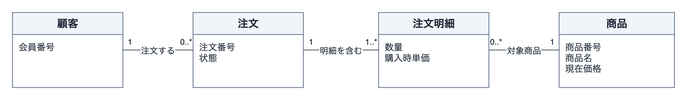

# draw.ioでドメインモデル図を作成するスキル

ドメインモデル図は、業務に必要な概念・関係・制約を整理し、チームの理解を具体例で確かめるための図です。「注文をキャンセルできる」という要件でも、出荷のどの時点まで許可するのか、決済済みなら何が必要かが不明なままでは、正しい実装を決められません。

このパターンは、そうした業務の説明から図を作るCodex用スキルを提供します。まず概念・属性・関連・多重度を整理し、設計が必要になった段階で不変条件・責務・集約候補へ進みます。成果物は、draw.ioで図形や接続線を再編集できる `.drawio.png` と、その判断を説明するMarkdownです。元の業務を完全に写すのではなく、目的に必要な情報を選びます。

## 全体像

配布ZIP内では、読み込む指示と、成果物を確かめる処理を同じスキルフォルダーにそろえます。スキルフォルダーだけを利用先へコピーしても、参照先が失われません。

```text
drawio-domain-model/
  README.md
  ci.json
  skills/drawio-domain-model/
    SKILL.md
    references/
      modeling.md
      drawio.md
    assets/model-notes.md.template
    scripts/validate_drawio.py
  examples/
    order-cancellation.md
    order-cancellation.drawio.png
  tests/test_validate_drawio.py
```

`SKILL.md` が入口です。業務の意味を整理するときは `references/modeling.md`、セルの組み立て・PNG書き出し・検査では `references/drawio.md` を読みます。判断メモのひな形は、概念を置いた理由や未決事項を図と対応付けるために使います。検査CLIは、できあがったPNGと埋め込まれた全ページの構造を確認します。

## 業務の理解から図へ進む手順

### 概念と設計を段階で分ける

`skills/drawio-domain-model/SKILL.md` は、業務を具体的な出来事から調べるよう指示します。

```md
具体的な出来事から、誰が何をどの対象に対して行うかをたどる。
```

この抜粋に続く指示では、入力・資料・確認結果で分かったことを、仮定や質問と分けます。例えば「出荷前ならキャンセル可能」という入力には、倉庫での作業開始と配送業者への引き渡しのどちらを出荷と呼ぶのか、という確認が必要です。図を完成させるために曖昧な語を確定するのではなく、結果を変える不足を質問または未決の注記にします。

同じファイルは、図の種類が指定されていなければ概念モデルから始めるよう指示します。概念モデルには業務用語の箱、必要な属性、関連、制約を描き、言語の型やDBの外部キーを入れません。Larmanの[分析のドメインモデル](https://www.oreilly.com/library/view/applying-uml-and/0130925691/0130925691_ch10lev1sec2.html)の視点と、Fowlerの[振る舞いを含むDomain Model](https://martinfowler.com/eaaCatalog/domainModel.html)を区別するためです。

設計モデルを求めた場合は、別ページでEntity・Value Object・振る舞い・責務・集約候補を検討します。「注文は明細の親だから同じ集約」とは決めず、どの条件を同時に守る必要があるかを理由にします。この考え方は、[Vernonが説明する不変条件と整合性境界](https://www.informit.com/articles/article.aspx?p=2020371&seqNum=2)に基づきます。モデルの適用範囲を示すBounded Contextは、集約やサービスの分割とは別に扱います。

### 名詞から候補を出し、具体例で選ぶ

`references/modeling.md` では、概念の候補を独立させる理由を説明します。例えば「キャンセル」という名詞があっても、状態を変えるだけなら注文の振る舞いとして扱えます。申請者・承認者・審査履歴を別に管理する必要があるなら、キャンセル申請を独立させる理由になります。

属性も、具体的な業務上の違いから選びます。商品価格を1,000円から1,200円に変更しても過去の注文金額を変えてはいけないなら、現在価格と購入時単価を区別します。これは、名詞の一覧をそのまま箱に変えるだけでは見落としやすい判断です。

関連は両方向に読み、多重度を確認します。顧客側の `1`、注文側の `0..*` は、1件の注文に顧客が1人、1人の顧客に注文が0件以上あるという意味です。未注文の会員と複数回注文した会員を当てはめることで、端に置く数とその根拠を確かめます。処理順や状態遷移の矢印は、構造の関連線へ混ぜません。

### 図と説明を分ける

`skills/drawio-domain-model/SKILL.md` は、説明の置き場所も指定します。

```md
目的・対象範囲・用語の解説・凡例・仮定の根拠・設計理由・未決事項の一覧はdraw.ioの外のMarkdownへ書き、ページ名と要素名で図へ対応付ける。
```

draw.ioには概念・属性・関連・多重度などのモデルを描きます。図を読むための説明は判断メモに置くため、図の余白を長い文章で埋めたり、説明専用のdraw.ioページを追加したりしません。例えば現在価格と購入時単価の違いは2つの属性として図に表し、過去の金額を変えない理由や価格変更の具体例はMarkdownで説明します。

図の中で補足が必要なら、何と何の関係を伝えるかに合わせて図の表現を選びます。集約候補は要素を包含する境界、キャンセル条件は状態遷移の短いガードとして表せます。構造だけでは伝わらない不変条件は、担当する要素に結び付いた短い制約ノートで示します。説明文を図へ戻す前に、接続・包含・境界などで意味を表せるかを検討する手順です。

## 注文キャンセルの作例

`examples/order-cancellation.md` と `examples/order-cancellation.drawio.png` は対応する学習例です。図の多重度やルールは学習用の仮定であり、その根拠は図外のMarkdownに記載します。実業務の確認済み要件とはしていません。



PNGとして見えるのは「概念モデル」ページです。顧客・注文・注文明細・商品の箱と属性、関連名、両端の多重度を配置しています。図の目的・範囲や多重度の読み方は、同梱Markdownの「目的・範囲と用語」「ページと記法の読み方」で説明します。

draw.ioで開くと「設計候補」「注文状態遷移」も含む全3ページを編集できます。設計候補では注文集約の候補を囲み、Orderから短い制約ノートへの接続で不変条件の担当を表します。状態遷移では状態・操作・ガードを描きます。設計理由や二重要求・競合の未決事項は、図中の説明枠ではなくMarkdownから各ページと要素名に対応付けます。

同梱の判断メモは、R1を出荷確定前のキャンセル、R2を出荷確定後の拒否、R3を決済済みの場合の返金として整理します。一方、二重要求への応答、出荷との競合、返金だけ失敗した場合、在庫の解放条件はQ1〜Q4の未決事項です。キャンセル成立と返金完了を別の事実として扱うことで、後続処理の失敗を注文の状態へ混ぜて解決済みにすることを防ぎます。

`skills/drawio-domain-model/assets/model-notes.md.template` は、次の列でルールと図をつなぎます。

```md
| ID | ルールと根拠・確定状況 | 前提状態と操作 | 期待結果または質問 | 図の対応箇所 |
| --- | --- | --- | --- | --- |
```

図を見ただけでは分からない根拠や具体例を残すための表です。期待結果が不明なら質問として記録し、確定したルールと同じ扱いにしません。対象業務に無関係な節は省略でき、例を埋めるために要件を追加する必要はありません。

## XMLから再編集できるPNGへ書き出す

`references/drawio.md` には、ページと図形を定義する最小例があります。

```xml
<mxfile>
  <diagram id="conceptual" name="概念モデル">
    <mxGraphModel page="1" pageWidth="1200" pageHeight="800">
      <root>
        <mxCell id="0"/>
        <mxCell id="1" parent="0"/>
        <mxCell id="order" value="注文&#xa;注文番号・状態"
                vertex="1" parent="1" style="whiteSpace=wrap;html=0;">
          <mxGeometry x="40" y="40" width="240" height="120" as="geometry"/>
        </mxCell>
      </root>
    </mxGraphModel>
  </diagram>
</mxfile>
```

`mxfile` の中の `diagram` がページで、その `root` に図形や接続線のセルを置きます。`order` は図形のIDであり、名前を変えても接続先を追えるように使います。`parent="1"` はレイヤーへの所属、`vertex="1"` は図形、`mxGeometry` は位置と大きさです。関連には `edge="1"` と両端のセルIDを指定します。関連名や多重度も独立したラベルにすると、接続線との対応を保持できます。

`page="1"` はページ枠を有効にし、幅1200・高さ800の横長の作業領域を置きます。図形の位置 `x="40"`・`y="40"` は作業領域の端から余白を取り、幅240・高さ120は注文名と属性を収める例です。`whiteSpace=wrap` は長いラベルの折り返し、`html=0` はHTMLではなく通常のテキストとしての表示を指定します。`&#xa;` の改行で注文名と属性を分けます。ここで省略した表示設定はdraw.ioの既定値を使い、対象図ではPNGを見て必要な余白と文字サイズへ調整します。

この作業XMLは一時ファイルです。最終的にはdraw.ioで描画し、図のコピーを含むPNGとして書き出します。同じ参照文書のCLI例は次のとおりです。

```sh
"$DRAWIO_BIN" --export --format png --embed-diagram --border 24 \
  --scale 1.5 --timeout 60 \
  --output output/domain-model.drawio.png /tmp/domain-model.drawio
```

`DRAWIO_BIN` に利用環境の実行ファイルを指定します。`--export` と `--format png` は実際の画像を生成し、`--embed-diagram` は全ページを再編集するための図データを含めます。`--border 24` は周囲の余白、`--scale 1.5` は画像の拡大率です。画像は既定で先頭ページを描き、`--timeout 60` は書き出しが終わらない場合に60秒で失敗させます。これらは作例を読みやすく渡すための選択であり、業務ルールではありません。

GUIではPNGの書き出し時に **Include a copy of my diagram** と図全体・全ページの設定を選びます。[draw.io公式のPNG説明](https://www.drawio.com/docs/manual/export/export-to-png/)にある再編集用の保存方法です。PNGに変換しただけでは図データを失う場合があるため、拡張子を `.drawio.png` にしたことだけで完成とはしません。

## PNGと全ページの構造を検査する

`skills/drawio-domain-model/scripts/validate_drawio.py` の入口は、画像を読んでから全ページを検査します。

```python
def validate(path):
    with Path(path).open("rb") as source:
        data = source.read(MAX_FILE + 1)
    budget = ExpansionBudget()
    width, height, xml = read_png(data, budget)
    models = page_models(xml, budget)
    for name, model in models:
        validate_model(name, model)
    return width, height, [name for name, _ in models]
```

`read_png` はシグネチャと必須チャンク、CRC、画像データの展開・行サイズ・フィルター番号を確かめ、draw.ioのテキストチャンクからXMLを取り出します。`page_models` は非圧縮XMLと圧縮されたページを読み、`validate_model` がセルIDの重複、親や接続先の参照、必要なジオメトリを調べます。画像として壊れているファイルと、画像は見えても編集用の図データがないファイルを、どちらも失敗として扱います。

対象は静止・非インターレースPNGです。入力は32MiBまでです。`ExpansionBudget` はPNGの画像データ、図メタデータ、各圧縮ページの展開後のバイト数を合計し、ファイル全体で64MiBまでに制限します。展開処理にも残量に応じた上限を渡すため、各ページが上限未満でも、合計が上限を超える入力は失敗します。重複した図メタデータは展開前に拒否します。上限を超える場合は倍率を下げるか、図を意味のまとまりで分けて再確認してください。文字列やXML解析にもメモリを使うため、この値はプロセスのメモリ使用量そのものの上限ではありません。検査CLIはファイルを書き換えず、ネットワークへ送信しません。

この検査は、画像の内容とXMLの意味が一致するか、文字が読みやすいか、業務ルールが妥当かまでは判定しません。各ページをCLIで一時PNGへ書き出し、文字と線を画像で確認したうえで、具体例と業務担当者の理解を照らし合わせます。GUIでのコピー上の編集・PNG保存・再読み込みは、利用者が希望する場合などの追加確認です。XMLの直接作成からCLIでの描画・埋め込み検査までで進められるよう、通常の作図にGUI操作を必須としません。

## 導入・使用方法

Python 3.12以上、スキルを利用するCodex、PNG書き出し用のdraw.io Desktop CLIを用意します。追加のPythonライブラリは不要です。図のXMLは直接作成し、CLIで図データ入りPNGへ変換します。CLIを使えない場合はエディターでの書き出しを代替手段にできます。ZIP展開先のREADMEに、環境・コピー先・呼び出し・検証の手順をまとめています。

利用先の `.agents/skills/drawio-domain-model/` へ配布物の `skills/drawio-domain-model/` をコピーし、Codexへ次のように依頼します。

```text
$drawio-domain-model
注文キャンセルの成立条件を整理する概念モデルを作成してください。
出荷確定前はキャンセルでき、決済済みなら返金が必要です。
再キャンセル要求と返金失敗時の対応はまだ決まっていません。
docs/models/ に図データ入り.drawio.pngと判断メモを保存してください。
```

スキルは入力にない条件を未決として示し、目的に必要な概念から図を作ります。設計候補が必要なら、その旨を追加します。draw.ioを利用できずPNGを書き出せない環境は、生成を未実施として報告する手順です。

## 検証方法と結果

配布ルートで次を実行します。

```sh
python3 skills/drawio-domain-model/scripts/validate_drawio.py examples/order-cancellation.drawio.png
python3 -m unittest discover -s tests -v
```

`ci.json` もPython 3.12と同じテストコマンドを指定します。テストには図データ入りPNGの作例と一時生成した破損例を使い、元の作例を変更しません。期待結果は、作例が全3ページを含む正常なPNGとして通り、図データ欠落・CRC不一致・画像破損・XML破損・参照切れなどが非0終了になることです。

2026年10月24日、macOS arm64、Python 3.15.0、draw.io Desktop 32.6.1で作例のPNG生成と構造検査を確認しました。検査は2058×303のPNGと全3ページを受理しました。全3ページをCLIでPNGへ描画して目視し、概念図は4概念・属性・関連・多重度、設計候補は境界・責務と対象に結び付いた短い制約ノート、状態遷移は状態・操作・ガードとして読めることを確認しました。目的・範囲・仮定・凡例・設計理由・未決一覧を図中へ置かず、各ページの要素名からMarkdownの説明へ対応させています。出荷確定済みからキャンセル済みへの矢印もありません。

構造検査の10件のテストが成功しました。正常な作例と代表的な破損例に加え、各24MiBの圧縮ページを3つ含む入力を累積展開量の超過として拒否しました。重複した図メタデータを展開前に拒否し、画像とメタデータの合計が上限と等しければ受理し、1バイトでも超えれば拒否することも確認しました。

同梱作例を作った担当とは別のエージェントが、会員による図書館の貸出という短い入力でスキルを試しました。1007×191の1ページPNGと図外の判断メモを作成し、PNG・埋め込みXMLの構造検査に成功しました。図中は会員と資料の2概念、1本の関連、両端の未決の多重度で構成し、読み方・根拠・未決事項はMarkdownへ分けました。入力にない貸出上限・期限・延滞条件を確定せず、未決として保持しました。これは別業務の入力に対する一度の試行であり、あらゆる業務での振る舞いを保証するものではありません。

同日、配置・文書検査、共通テスト、型検査、サイトビルド、E2Eの必須6検証と、生成ZIPを別の一時ディレクトリへ展開した個別検証が成功しました。Chromeでは一覧、ヘッダーからサイドバー、検索「ドメインモデル」から対象文書へ到達でき、本文・作例PNG・XMLとCLIのコード表示を確認しました。本文から取得したZIPは生成ZIPとSHA256が一致し、CRC検査とREADME・スキル本体・作例PNG・テストの収録確認も成功しました。

これらの画面・取得内容の確認はAIが実施しました。GUIでの編集保存再読み込みは利用者の意向により省略し、未実施として扱います。業務ルールと説明の分かりやすさについての人間の最終確認も未実施です。

## 参考資料

- [Craig Larman：Domain Models（公開プレビュー）](https://www.oreilly.com/library/view/applying-uml-and/0130925691/0130925691_ch10lev1sec2.html)：分析の概念モデル。
- [Martin Fowler：Domain Model](https://martinfowler.com/eaaCatalog/domainModel.html)、[Bounded Context](https://martinfowler.com/bliki/BoundedContext.html)：振る舞いを含むモデルと用語の適用範囲。
- [Vaughn Vernon：不変条件と整合性境界](https://www.informit.com/articles/article.aspx?p=2020371&seqNum=2)：集約候補を考える根拠。
- [Domain Storytelling](https://domainstorytelling.org/quick-start-guide)、[Example Mapping](https://cucumber.io/blog/bdd/example-mapping-introduction/)：具体的な業務と例から理解を確かめる方法。
- [draw.io：PNG書き出し](https://www.drawio.com/docs/manual/export/export-to-png/)、[PNG内の図データ](https://www.drawio.com/docs/manual/export/xml-in-png/)、[Desktop CLI](https://github.com/jgraph/drawio/wiki/Desktop-App)：編集可能なPNGの保存方法。

## ダウンロード

[実装をダウンロード](/downloads/patterns/development/skills/drawio-domain-model.zip)
