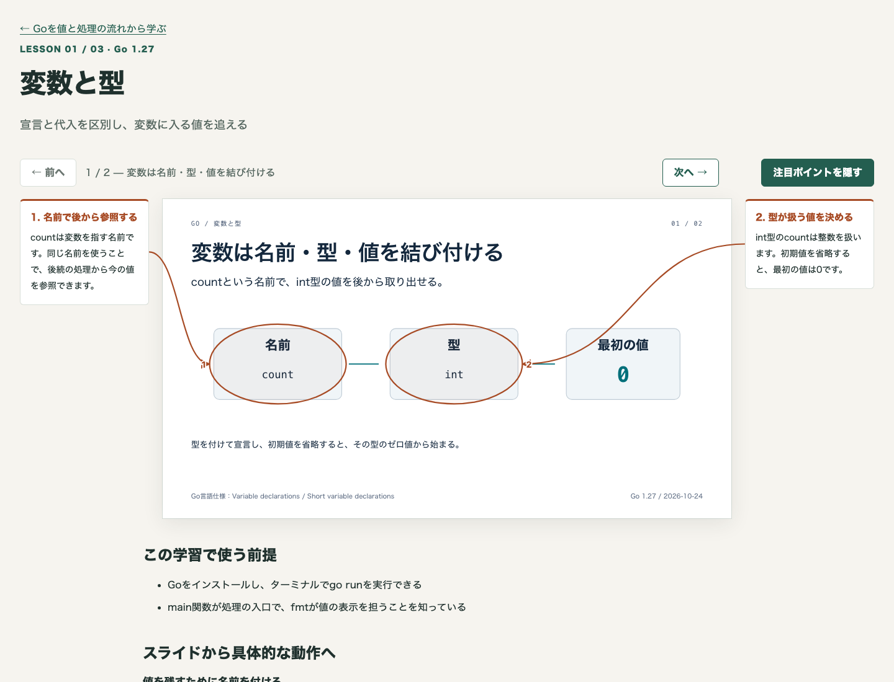

# 技術を体系的に学ぶHTML教材スキル

新しい言語やライブラリを学ぶときは、個々の用語の説明だけでなく、どの前提を先に理解し、次に何を確かめるかという順序が必要です。このパターンは、その順序と公式資料の取得手順を対象専用のスキルに残し、学習項目ごとにHTML教材を作るためのキットです。

各ページでは、[html-deck](https://github.com/nogikun/skills/tree/2d638228f0104fa6ebfad6447bb1652379e1da78/skills/html-deck)で作った短いスライドを中央に置きます。スライドに詰め込みきれない前提、処理の流れ、完全な実行例、練習と解説は、その下で読めます。左右の説明から注目する箇所へ矢印と丸枠を表示し、スライドだけ見たいときはボタンで隠せます。

スキルが資料の調査と教材の執筆を案内し、同梱CLIが確定したデータからページや専用スキルを生成します。`setup`コマンドだけで教材本文が完成したり、公式資料の取得が済んだりする構成ではありません。Goの参照教材は、変数と型、制御構文、関数の3項目を収録しています。

## 学習ページの表示

中央のスライドで全体像を見て、左右の説明から注目する箇所を確かめます。その下には前提から具体的な動作へつながる本文が続きます。「注目ポイントを隠す」で左右の説明と丸枠・矢印を非表示にしても、現在のスライドと本文は保たれます。



## 全体像

ZIP内の配置は次のとおりです。`courses/`が教材の正本で、`build/site/`はそれを表示するための生成先です。

```text
learning-deck-kit/
  .claude/skills/
    learning-setup/
      SKILL.md
      references/authoring.md
      scripts/                  教材検査・HTML・専用スキル生成
      assets/web/               外側のページと注目表示
      vendor/html-deck/         固定版のスライド制作スキルとCLI
    impl/                       キットの実装・変更用
    review/                     キットのレビュー用
  courses/go/
    profile.json                技術・対象版・資料・学習順序
    lessons/
      variables/                変数と型
      control-flow/             制御構文
      functions/                関数
        lesson.json             外側の説明と注目箇所
        deck/
          deck.md               スライドの目的と構成
          theme.css             スライドの見た目
          index.html            html-deckのビューア
          slides/01.html
          slides/02.html
  tools/                        検査・配信の入口
  tests/                        モデル・CLI・ブラウザ検査
  docs/design/                  判断理由・規則・収束結果
  .foundation/                  規則と違反例の検査
  build/site/                   生成した学習ページ（配布の正本に含めない）
  vendor-lock.json               上流ファイルの固定情報
  ci.json
  README.md
```

`learning-setup`は、利用先の`.agents/skills/`または`.claude/skills/`へ丸ごと持ち込めます。専用スキルを生成すると、例えば`learn-go/`に目標、公式資料一覧、取得・更新手順が置かれ、兄弟の`learning-setup/`に教材を作る共通処理が置かれます。対象ごとの情報と共通の表示処理を分けるため、新しい技術を追加するときに表示エンジンへ技術名を書き足す必要はありません。

`scripts/model.mjs`が入力を検査し、`scripts/render.mjs`がHTMLとスキル本文を組み立て、`scripts/learning.mjs`がファイルを読み書きします。ブラウザでの移動や注目表示は`assets/web/learning.mjs`が担当します。教材用のCLIと閲覧ページに外部の実行時ライブラリはなく、開発用の検査依存はキットの`package-lock.json`へ分離しています。

## 技術・資料・学習順序をひとつのprofileに残す

### 誰が何を学ぶかを固定する

`courses/go/profile.json`の対象と読者の部分です。

```json
{
  "schemaVersion": 1,
  "id": "go",
  "title": "Goを値と処理の流れから学ぶ",
  "technology": "Go",
  "version": "1.27",
  "goal": "値、条件による処理の分岐、関数の入出力を追い、短いGoプログラムの結果を説明できる",
  "audience": "Goで変数、制御構文、関数を初めて学ぶ人"
}
```

`schemaVersion: 1`は、このキットが受け付けるデータ形式です。`id`はコースの識別子で、ディレクトリ名と`learn-go`という生成スキル名に使います。`title`は教材の表題、`technology`と`version`は学ぶ技術と対象版で、`goal`と`audience`が説明の範囲と始点を決めます。Goの参照例では、すべての言語機能を網羅するのではなく、値と処理の流れを読めるところまでを目標にしています。

IDは英字で始まる小文字・数字・ハイフンに限定します。対象版に`latest`や`未確認`は使えません。版を特定しておくことで、後から公式資料が更新されても、何を前提に書いた教材なのかを確認できます。これらのキーはすべて必須で、未知のキーも検査で拒否します。新しい入力を用意するときは、スキル内の`references/authoring.md`にある全体形式を使います。

### 資料のURLと確認日を、取得手順につなげる

同じ`profile.json`の資料部分から、先頭の出典を抜粋します。

```json
{
  "officialHosts": ["go.dev"],
  "sources": [
    {
      "id": "variables",
      "title": "Go言語仕様：変数宣言",
      "url": "https://go.dev/ref/spec#Variable_declarations",
      "version": "go1.27",
      "checkedAt": "2026-10-24"
    }
  ]
}
```

`officialHosts`には資料のホスト名だけを書き、`sources[].url`をそのホストのHTTPSへ限定します。ユーザー名・パスワード・独自ポートを含むURLは受け付けません。この制限は参照先の形式を確かめるもので、そのサイトが公式かどうかを自動で判断するものではありません。制作時に公式サイト、リポジトリ、レジストリの情報を照合してから登録します。

出典の`id`は、後述の学習項目から資料を指定するための名前です。`title`は資料一覧の表示名、`url`は根拠の節、`version`は資料が扱う版、`checkedAt`は実際に本文を確認した日です。コースの対象版`1.27`と、資料側の表記`go1.27`はそれぞれ保存します。確認日は実在する`YYYY-MM-DD`かを検査しますが、日付を書くだけで本文の確認が済んだことにはしません。

`setup`と`sync-skill`は、この情報から`learn-go/references/sources.md`と`workflow.md`を生成します。取得手順は、登録URLを開き、本文と対象版を確認し、言語仕様・導入資料・リリースノートを突き合わせる流れです。404、取得拒否、JavaScriptの外枠だけのページは、本文を取得できた結果に数えません。例えば今回のGo教材では、本文を確認できた[Go言語仕様](https://go.dev/ref/spec)を説明の根拠にしています。

`sources`コマンドはURL・版・確認日の表示です。ネットワーク取得は行いません。更新するときは、専用スキルの手順で資料を再取得し、影響する本文、コード、出力、注目点を直してから、確認した出典だけの日付を更新します。最後に`sync-skill`を実行することで、教材側のprofileと専用スキル側の資料一覧をそろえます。

### 前提を先に置き、学習の順序を検査する

`profile.json`の`curriculum`は、表示順と前提関係の正本です。

```json
{
  "curriculum": [
    {
      "id": "variables",
      "title": "変数と型",
      "goal": "宣言と代入を区別し、変数に入る値を追える",
      "dependsOn": []
    },
    {
      "id": "control-flow",
      "title": "制御構文",
      "goal": "条件による分岐と繰り返しの順序を追える",
      "dependsOn": ["variables"]
    },
    {
      "id": "functions",
      "title": "関数",
      "goal": "引数から戻り値までの流れを説明できる",
      "dependsOn": ["variables", "control-flow"]
    }
  ]
}
```

各項目の`id`は`lessons/<id>/`とページのURLに対応し、`title`と`goal`を各`lesson.json`でも一致させます。`dependsOn`には、この配列で先に出た項目だけを指定できます。まだ説明していない関数を前提にしてしまうような順序の逆転は、生成前に検出します。

参照教材は、変数で値を追い、その値を条件にして処理を選び、最後に関数の入力と結果を追う順序です。これはGo公式が強制する唯一の順序ではなく、初学者が前提を積み上げるためにこのキットが選んだ順序です。生成する一覧と前後のページリンクは配列の順序から決まり、リンクの追加管理は不要です。

## スライドの外側に、前提から動作までを書く

`courses/go/lessons/variables/lesson.json`の入口部分です。

```json
{
  "schemaVersion": 1,
  "id": "variables",
  "title": "変数と型",
  "goal": "宣言と代入を区別し、変数に入る値を追える",
  "prerequisites": [
    "Goをインストールし、ターミナルでgo runを実行できる",
    "main関数が処理の入口で、fmtが値の表示を担うことを知っている"
  ]
}
```

`schemaVersion`・`id`・`title`・`goal`は、profileにある項目と照合します。`prerequisites`は、このページを読む時点で使う知識です。「型」「変数」と単語だけ並べるのではなく、何ができることを前提にするかを書きます。

説明本文は同じファイルの`explanation`へ分けて保存します。次は最初のまとまりです。

```json
{
  "explanation": [
    {
      "title": "値を残すために名前を付ける",
      "body": "後から同じ値を使うには、値に名前を付けておく必要があります。変数はそのための仕組みです。Goでは変数が扱う値の種類を型が決めます。この学びでは、数を扱うcountと文字列を扱うnameを使い、宣言した後に値がどう変わるかを追います。",
      "code": "",
      "output": ""
    }
  ],
  "exercise": {
    "prompt": "count = 3の行を取り除くと、最後に何が表示されますか。var count intの直後の値から説明してください。",
    "answer": "Go: 0 lessonsと表示されます。int型を初期値なしで宣言したcountは0から始まり、更新する行がなくなったため、Printfへ0が渡ります。"
  },
  "sources": ["variables", "short-declarations"]
}
```

`explanation[].title`がまとまりの見出し、`body`が意味と処理のつながりです。実行するコードがあるまとまりには`code`と`output`を入れ、説明だけなら空文字にします。生成処理はコードを実行せず、これらをエスケープしてコード欄と期待結果欄へ表示します。実行済みかどうかは本文へ環境と結果を明記し、検証コマンドでも出力を照合します。

`exercise.prompt`は自分で値や動作を予測する問い、`answer`は結果に至る理由です。答えはページの「解説を読む」で開きます。`sources`は、この学びに使ったprofile側の出典IDで、未登録のIDは拒否します。

変数のページでは、スライドに短い宣言と代入を置き、その下の本文に`package main`から始まる完全なコードを置きます。`var count int`で用意した値は0から始まり、`count = 3`で更新されるため、最後の表示は`Go: 3 lessons`です。スライドで関係をつかんだ後、ページ内のコードを保存して確かめられるようにしています。

## 左右の説明と、スライド上の注目箇所を対応させる

### 位置ではなく、対象要素のIDを指定する

同じ`lesson.json`の`slides`から、2枚目の一部を抜粋します。

```json
{
  "slides": [
    {
      "file": "02.html",
      "title": "宣言した変数の値を代入で更新する",
      "notes": [
        {
          "id": "declaration-note",
          "target": "declaration",
          "side": "left",
          "title": "最初に変数を宣言する",
          "body": "var count intでint型のcountを用意します。初期値を省略したため、宣言直後の値は0です。"
        },
        {
          "id": "assignment-note",
          "target": "assignment",
          "side": "right",
          "title": "同じ変数へ新しい値を入れる",
          "body": "count = 3は既存変数の更新です。最後の表示には更新後の3が使われます。"
        }
      ]
    }
  ]
}
```

`file`は`deck/slides/`内のHTMLファイル名、`title`は現在枚の表示とiframeの名前です。URLや`../`、サブディレクトリは指定できません。各`notes`の`id`が説明カードとSVGの対応、`target`がスライド内の要素、`side`が説明を置く左右を決めます。`title`と`body`には、その箇所が何を受け取り、どう変わり、次へ何を渡すかを書きます。同じスライドでIDと対象を重複させることはできません。

`deck/slides/02.html`では、対象へ安定した名前を付けます。

```html
<span data-learning-target="assignment">count = 3</span>
```

ページ側のJavaScriptが`data-learning-target="assignment"`の要素を探すため、教材作者が丸枠の座標を手入力する必要はありません。対象が0個、2個以上、表示寸法が0のときはエラーを表示します。スライドの構造を変えるときは、この属性と説明も同時に更新します。

### 1600×900の座標を、表示中の大きさへ変換する

`assets/web/learning.mjs`の座標変換です。

```js
const scaleX = frame.width / CANVAS_WIDTH;
const scaleY = frame.height / CANVAS_HEIGHT;
return {
  x: frame.left - overlay.left + target.left * scaleX,
  y: frame.top - overlay.top + target.top * scaleY,
  width: target.width * scaleX,
  height: target.height * scaleY,
};
```

html-deckのスライドは1600×900で作り、親ページが幅に合わせて縮小します。`getBoundingClientRect()`で得る対象の位置はiframe内の表示領域が基準なので、親ページへそのまま移すと位置がずれます。iframeの縮小率を掛け、親のSVGまでの差を足すことで、同じ箇所へ丸枠を描けます。[DOMRectの座標系](https://developer.mozilla.org/en-US/docs/Web/API/Element/getBoundingClientRect)に合わせた変換です。

SVGの`viewBox`は外側の表示領域と同じ寸法にします。丸枠は対象の中心と幅・高さから作る楕円で、周囲へ7pxの余白を足します。矢印は説明カードの端から丸枠へ結び、狭い画面でカードが下へ回ったときは左右の余白を経由して、他のカードの本文を横切らずにつなぎます。SVGは`aria-hidden="true"`と`pointer-events: none`にし、内容の読み上げやボタン操作を妨げないようにしています。

位置はiframeの読み込み、親領域の寸法変更、フォントの準備完了、スライド内のアニメーション・トランジションの終了、注目表示のON復帰で測り直します。切替前の読み込みが遅れて完了しても、現在枚と改訂番号が一致するものだけを描画します。

この計測には親とスライドが同一オリジンであることが必要です。[contentDocumentの条件](https://developer.mozilla.org/en-US/docs/Web/API/HTMLIFrameElement/contentDocument)に従い、同じHTTPサーバーから配信します。iframeは`sandbox="allow-same-origin"`で、スライド内のスクリプトは許可しません。`file://`や外部サイトの埋め込みは、注目表示の対応条件に含めていません。

### 学んでいる位置を保ったまま、補足を出し入れする

現在のスライドは`#slide-1`、`#slide-2`というURLのhashへ保存します。前後ボタン、左右キー、Home・Endで移動でき、先頭・末尾の前後ボタンは無効になります。ブラウザの戻る操作でも親ページのhashから現在枚を復元します。iframe自身の遷移は`location.replace`を使い、親の履歴と分かれて戻る回数が増えることを防ぎます。

注目表示は初期状態がONです。OFFにすると左右カードとSVGを隠し、スライドが使う幅を広げます。本文と現在枚は維持し、再びONにしたら新しい大きさで注目位置を計測します。状態は`aria-pressed`にも反映します。

1100px以下ではカードをスライド下の2列へ、600px以下では1列へ移します。説明と丸枠には同じ番号を表示するため、矢印が長くなる画面でも対応を追えます。完全なコードと説明はページ下部で読める構成です。

番号は、スライド内の実際の文字の行と番号の幅を計測して、対象に近い空白へ置きます。番号の白い縁も文字や他の番号へ重ねず、スライド内へ収めます。これにより、縮小したコードの隣の行を番号で覆うことを防ぎます。余白が見つからない場合はエラーを表示するため、教材側の文字量や注目箇所を見直します。

## 専用スキルとページの再生成で、編集したファイルを守る

`scripts/learning.mjs`は`setup`でprofileと`learn-<id>`を新規生成します。登録した資料と順序が専用スキルへ引き継がれ、共通処理である`learning-setup`も指定したスキル用ディレクトリへコピーします。異なる内容の既存ファイルがあれば、書き込み前に衝突として停止します。同じ場所にある自分自身はコピーしません。

`sync-skill`と`build`の出力先には`.learning-generated.json`を置きます。これは`schemaVersion`とコース`id`に加え、生成した相対パスと各ファイルのSHA-256を記録する所有台帳です。再生成前に台帳と実ファイルを照合するため、生成後に手編集したファイルがあれば、そのまま上書きせず停止します。空でない出力先に台帳がない場合や、新しい生成物と利用者ファイルが衝突する場合も失敗します。

正常な再生成では記録した生成物だけを更新し、不要になった生成物だけを削除します。無関係なファイルは残ります。入力コースと重なる場所へのページ生成や、書き込み先のシンボリックリンクも拒否します。修正は生成HTMLではなく`profile.json`、`lesson.json`、`deck/`へ戻し、再生成します。

## 指定のhtml-deckと、開発基盤の固定値

`vendor-lock.json`は、取り込み元`nogikun/skills`のコミット`2d638228f0104fa6ebfad6447bb1652379e1da78`と、同梱ファイルのハッシュを保存しています。`tools/structure.mjs`が内容を照合し、検査を通すために上流の実装を変更することを防ぎます。html-deck本体のMITライセンスと、内包するdraw.ioスキルのライセンスも同梱しています。

スライドの生成と検査は、同梱`vendor/html-deck/tools`のCLIを`uv run --locked --python 3.14 --project`から呼びます。Python依存はその`uv.lock`で固定し、システムのGoogle Chromeで実測します。ブラウザ追加やスライドの検査は、学習ページのNode製CLIとは別の責務です。

キットの開発環境はNode.js 22.23.4を`.nvmrc`へ固定し、`package.json`では22系を指定しています。開発依存はPrettier 3.9.10、ESLint 10.13.0、TypeScript 7.0.2、Playwright 1.64.1、Node型定義22.20.5を固定しています。整形・lint・型・構造・単体・ブラウザ・Go例の確認と、抑止コメント・規則対応の検査を`npm run check`へ集約します。Go例だけは同梱コードの検証用であり、教材エンジンがGo専用という意味ではありません。

規則と検査の対応は`docs/design/rules.md`と生成される`enforcement-matrix.md`にあります。違反例は一時コピーへ入れて、想定した検査が失敗することを確かめます。独立エージェントによる書き方の収束結果は`docs/design/convergence-report.md`に分けて記録します。

## 導入・使用方法

ZIPを展開し、`learning-deck-kit/`内で作業します。Node.js 22.23.4、Python 3.14、uv、システムのGoogle Chromeを用意します。参照Go例まで検証する場合はGo 1.27系が必要です。詳しい準備とOS別の注意は同梱READMEを参照してください。

```sh
npm ci
npx playwright install chromium
npm run build
npm run serve
```

`http://127.0.0.1:4187/`でGoの学習一覧を開けます。各項目へ進み、スライドを移動しながら左右の説明を読み、下の実行例と練習へ進みます。`build`はGo参照教材を`build/site/`へ生成し、`serve`はそのディレクトリだけをローカル配信します。すでに配信された教材を見る人にNodeやPythonは不要です。

利用先へ専用スキルを生成する例です。

```sh
node tools/learning.mjs setup courses/go/profile.json learning/go .agents/skills
```

これで`learning/go/profile.json`、`.agents/skills/learn-go/`、`.agents/skills/learning-setup/`ができます。Codexでは利用先で`$learn-go`を使い、Claude Codeでは生成先を`.claude/skills`にして利用します。この段階の`learning/go/`には教材本文がないため、参照教材を使うなら`courses/go/lessons/`をコピーし、新しい技術ならスキルの制作手順で`lessons/`を執筆します。

新しい技術では、公式資料を調べてprofileの技術名・版・資料・目標・順序を用意し、そのprofileを`setup`へ渡します。各項目は同梱html-deckで作り、`lesson.json`の説明・出典・注目点を対応させてから、`check`、`build`、`sync-skill`を実行します。コマンドの全引数と制作手順はREADMEと`learning-setup/references/authoring.md`にあります。

## 検証方法と結果

2026-10-25時点で、参照教材のデータ検査と、3つの完全なGo例の出力一致を確認しています。資料を確認した日付は2026-10-24で、例はGo 1.27.3で実行しました。変数の例は`Go: 3 lessons`、制御構文の例は`learn 1`・`learn 2`・`review 3`、関数の例は`remaining 2`が実測した出力です。

html-deckの固定版、Python 3.14.9、macOSのシステムChromeで、一時コピーの3deck・計6スライドを実測しました。全deckで終了コード0、blockは0です。コード本文26pxを維持して見出しを54pxから60pxへ修正し、階層の指摘3件を解消しました。最終の内訳は次のとおりです。

| 対象          | block | review | info |
| ------------- | ----: | -----: | ---: |
| 変数と型・2枚 |     0 |      4 |    6 |
| 制御構文・2枚 |     0 |      4 |    6 |
| 関数・2枚     |     0 |      4 |    6 |

残ったreviewは視線の入口候補と意味要素の群化、infoは空白・間隔と図の寸法です。6枚の見出し・図・コード・注記を画像で確認し、文字切れ・重なりは見られませんでした。終了0はblockがないという結果であり、すべての所見や教材の意味の正しさを自動で確認したことにはしていません。

キット全体の再確認は、展開先で次を順に実行します。準備が失敗した場合は、後続を進めず環境を整えます。

```sh
npm run check
npm run verify:decks
python3 .foundation/bin/violation_probe.py --root .
python3 .foundation/bin/rules_check.py --root . --final
```

学習ページの統合ブラウザ11件・単体22件・Go例3件と、整形・lint・型・構造・guardの検査が成功しています。別の一時領域へ展開したZIPでも、依存準備から全検査、元のhtml-deck実測、違反例17件とcheckへの組込み7経路、規則の最終確認が成功しました。掲載サイトでは、カードから説明・画像・ZIPまでの導線を実ブラウザで確認しています。

独立エージェントによる変更範囲・命名・内容の比較と、違反を仕込んだレビューは、同梱実装の`docs/design/convergence-report.md`に記録します。検証の方法と出力は`docs/design/verification.md`です。3回の比較で、最終12実装の全検査と、全レビュアーの仕込み8件検出が成功しました。一方、新規教材の注目対象の選択・命名にR1が1件残り、names=0.667で基準0.8に届かないため、完全収束とはしていません。

参照スライドは別モデルで2回批評し、変数の2枚目にコード枠の余白の指摘が1件残っています。上流の2回上限に従い、現在の表示と指摘を`docs/design/reference-review.md`へ残しました。Safari・Firefox、Windows、実機の読みやすさ、人間による教材内容の最終確認も未確認です。

## 参考資料

- [html-deckの固定版](https://github.com/nogikun/skills/tree/2d638228f0104fa6ebfad6447bb1652379e1da78/skills/html-deck)：スライドの制作と実測
- [Go言語仕様](https://go.dev/ref/spec)：参照教材の概念と構文
- [Goのリリース履歴](https://go.dev/doc/devel/release)：資料と実行環境の版
- [iframeのcontentDocument](https://developer.mozilla.org/en-US/docs/Web/API/HTMLIFrameElement/contentDocument)：同一オリジンの条件
- [getBoundingClientRect](https://developer.mozilla.org/en-US/docs/Web/API/Element/getBoundingClientRect)：注目位置を測る座標系
- [ResizeObserver](https://developer.mozilla.org/en-US/docs/Web/API/ResizeObserver)：表示領域の寸法変化

## ダウンロード

[実装をダウンロード](/downloads/patterns/development/skills/learning-deck-kit.zip)
