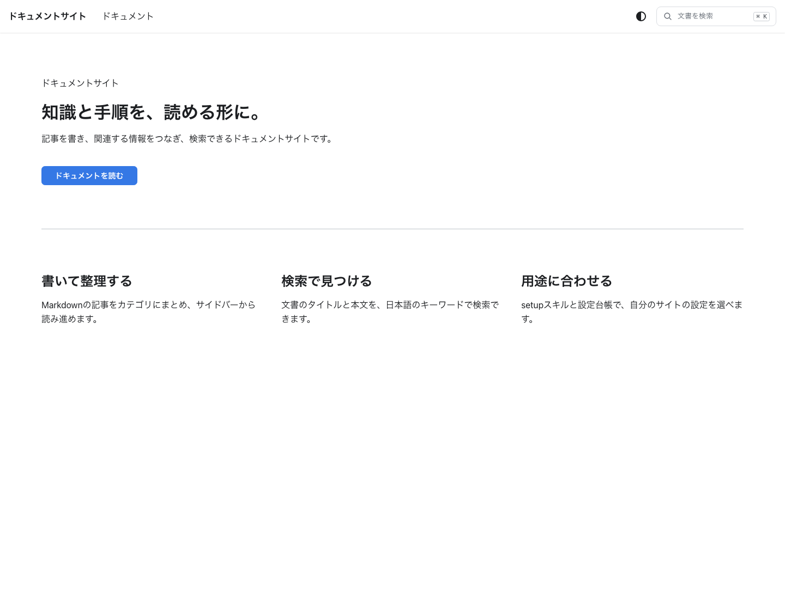
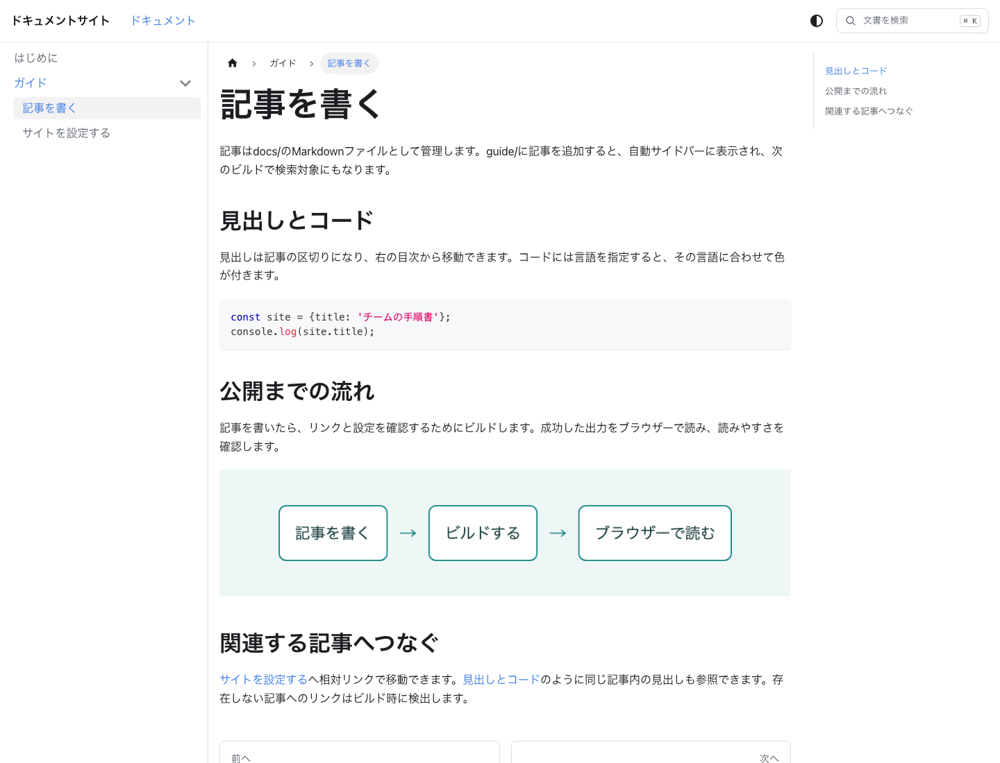
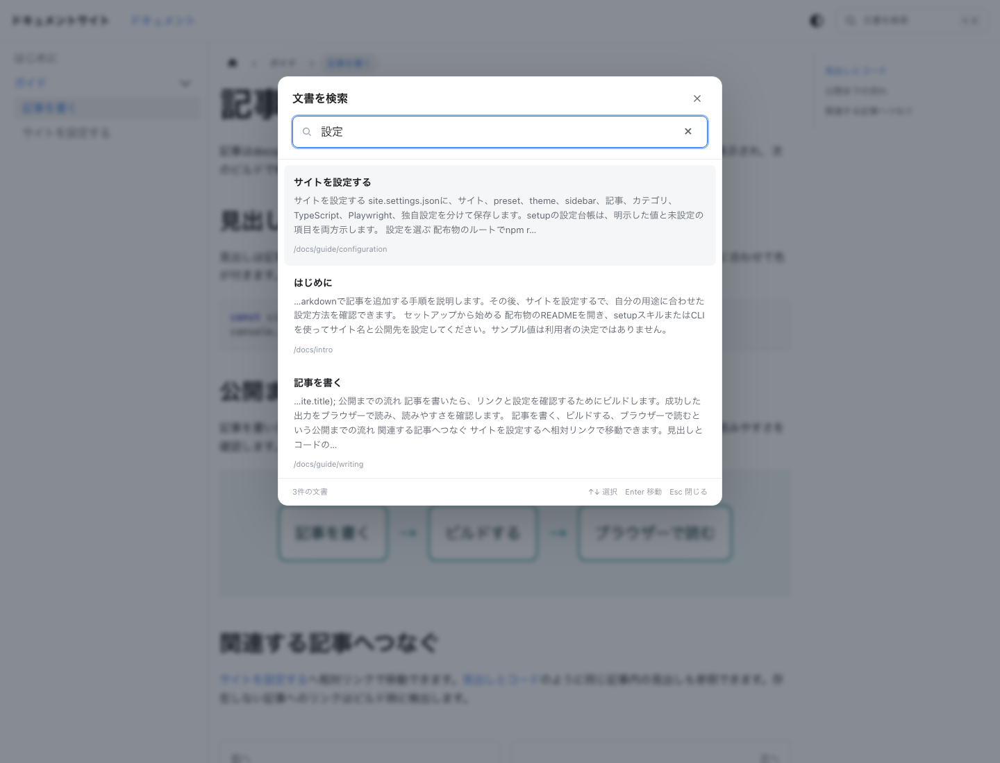
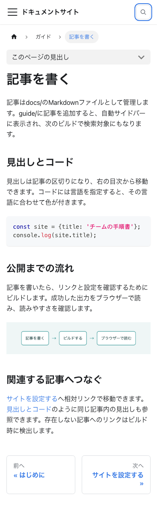

# Docusaurusで構築する日本語ドキュメントサイト

Docusaurusは、Markdownの記事とサイト設定から、ブラウザーで読める静的サイトを生成するOSSです。このパターンは、日本語の記事をサイドバーで整理し、タイトルと本文を検索できる文書サイトを作ります。

サイト名や公開先の初期値は動作例です。自分のサイトを作る際は、設定台帳でOSSと独自設定の両方を確認し、用途に合わせて選択します。未設定の項目も一覧へ残すため、明示した値だけを見てOSSの既定動作を見落とすことを防ぎます。

## 完成画面

ホームはサイトの目的と記事への入口を示します。ここで表示するサイト名と案内は、利用者の設定から読み込みます。



文書画面では、左のサイドバーから記事を選び、中央の本文を読み、右の目次から見出しへ移動できます。コードとPNGは記事に含めた実例です。



検索を開いて「設定」を入力すると、タイトルと本文の一致から記事を探せます。外部の検索サービスやAPIキーは必要ありません。



狭い画面ではサイドバーを収納し、本文を読み進められます。下は幅390pxで撮影した画面です。



## 全体像

ZIPを展開すると、次の構造になります。公開する記事とサイトの設定、設定を変える仕組み、動作の検証を同じ配布物にまとめています。

```text
docusaurus-basic/
  README.md                      導入・使用・検証手順
  site.settings.json             利用者が選んだ設定
  docusaurus.config.ts            OSSと独自設定をサイトへ渡す
  sidebars.ts                    設定からサイドバーを読み込む
  tsconfig.json                  setupが生成する型チェック設定
  docs/                          入門記事とガイド
  src/pages/index.tsx            ホーム
  src/theme/SearchBar/           検索画面
  plugins/site-search/           検索データ生成と検索処理
  setup/                         設定台帳、出典、検証・反映処理
  scripts/setup.mjs              セットアップのCLI
  .agents/skills/setup/          質問を進めるsetupスキル
  tests/                         設定、検索、ビルド、画面の検証
```

site.settings.jsonのsite・preset・themeはDocusaurusへ、sidebarはsidebars.tsへ渡します。customはホームと検索の独自設定です。typescriptはtsconfig.jsonへ、playwrightはブラウザーテストへ、documents・categoriesは記事やカテゴリのメタデータへ反映します。元のサイトのファイルを参照せず、このディレクトリだけで利用できます。

## サイトの名前と公開先

設定の保存先は`site.settings.json`です。以下では、配布時に指定している値を、表示、URL、記事、検索、開発・検証の順に説明します。値を省略しているOSSの設定は後述の設定台帳で確認できます。ここにある値は採用例であり、利用者がそのまま選ぶ必要はありません。

### サイト名とホームの説明を分ける

```json
{
  "site": {
    "title": "ドキュメントサイト",
    "tagline": "知識と手順を整理する"
  }
}
```

**`site.title`はサイト全体の名前です。** 特定の組織や製品を前提にしない動作例として「ドキュメントサイト」を入れています。Docusaurusのページタイトルに使われ、パターンのホームでもサイト名として表示します。記事ごとの`title`とは役割が異なり、ここを変えても記事の見出しやURLは変わりません。

**`site.tagline`はサイトの短い説明です。** 文書を整理するサイトという用途を示すサンプル値です。ホームの`Layout`へ`description`として渡すため、ホームの説明メタデータになります。画面の大見出しは後述の`custom.home.heading`なので、この値だけを変えてもホームの見出しは変わりません。

サイト名・URLなどのOSS側の役割は[Docusaurusの設定仕様](https://docusaurus.io/docs/api/docusaurus-config)で確認できます。ホームへの受け渡しは`src/pages/index.tsx`にあります。

### ドメイン、サイトの配信パス、記事の配信パス

```json
{
  "site": {
    "url": "https://example.com",
    "baseUrl": "/"
  },
  "preset": {
    "docs": {
      "routeBasePath": "docs"
    }
  }
}
```

**`site.url`には公開するドメインを指定します。** 配布物では公開先を決められないため、サンプルの`https://example.com`にしています。Docusaurusが絶対URLを作る際の基準になる値です。ローカル開発サーバーの待受先を指定する値ではなく、実際の公開時には自分のドメインへ変更します。

**`site.baseUrl: "/"`はドメイン直下への配置を表します。** まず単純な構成で起動できるようにした初期値です。`https://example.com/manual/`で公開する場合は`"/manual/"`に変えます。サイト内リンクやアセットの参照先にこの配信パスが反映されるため、配置先と一致していないと記事・画像・スクリプトを正しく取得できません。

**`preset.docs.routeBasePath: "docs"`は記事のURLに`/docs/`を付けます。** ホームと文書を別の入口にするため、この名前にしています。たとえば記事の`slug`が`/intro`なら、初期設定のURLは`https://example.com/docs/intro`です。`baseUrl`を`/manual/`にした場合は`https://example.com/manual/docs/intro`になります。

テストだけ別の配信パスにするため、`docusaurus.config.ts`には次の優先順位を設けています。

```ts
baseUrl: process.env.SITE_BASE_URL ?? resolved.site.baseUrl ?? '/',
```

`SITE_BASE_URL`があればその値を使い、なければ保存した`site.baseUrl`を使います。両方が未指定の場合だけ`/`になります。テストで`/preview/`を指定しても、利用者の設定ファイルは書き換わりません。`setup check`は保存値と実効値を両方表示し、一時上書きを確認できるようにしています。

## 不整合をビルドで検出する

公開後にリンク切れへ気付くことを減らすため、配布時は次の検出をすべてエラーとして扱います。どの不整合を扱うかは項目ごとに異なります。

```json
{
  "site": {
    "onBrokenLinks": "throw",
    "onBrokenAnchors": "throw",
    "onDuplicateRoutes": "throw",
    "markdown": {
      "format": "md",
      "hooks": {
        "onBrokenMarkdownLinks": "throw",
        "onBrokenMarkdownImages": "throw"
      }
    }
  }
}
```

### ページ・見出し・URLの重複

**`site.onBrokenLinks: "throw"`** は、存在しないサイト内ページへのリンクを検出したとき、ビルドを失敗させます。記事を移動・削除したあとも古いリンクが残る場合に、公開前に修正できるようにする選択です。

**`site.onBrokenAnchors: "throw"`** は、ページは存在していても、リンク先の見出しなどのアンカーが存在しなければビルドを失敗させます。見出し名の変更で目次以外からの参照が切れたことを見逃さないため、ページ単位のリンク検出とは別に有効にしています。

**`site.onDuplicateRoutes: "throw"`** は、複数のページが同じURLになるとビルドを失敗させます。記事の`slug`を明示する構成では、コピーした記事の`slug`を変更し忘れることがあるため、競合したまま出力しない設定にしています。

### Markdownの解釈とファイル参照

**`site.markdown.format: "md"`** は、通常の記事をMarkdownとして扱う指定です。文書を書くためにJSXの書式を意識する箇所を減らすため、このパターンでは`md`を選んでいます。`.md`の記事内にReactコンポーネントを記述する構成へ変える場合は、MDXの利用方針も含めて見直します。

**`site.markdown.hooks.onBrokenMarkdownLinks: "throw"`** は、`[サイトを設定する](./configuration.md)`のようなMarkdownファイルへの参照が解決できなければエラーにします。URLを手で組み立てるより、記事ファイルの改名・移動と参照の対応を確認しやすくするためです。

**`site.markdown.hooks.onBrokenMarkdownImages: "throw"`** は、``などの記事内画像が見つからない場合にエラーにします。本文だけが表示され、説明に必要な図が欠落した状態で公開することを防ぐために指定しています。

検出対象とエラーの扱いは[Docusaurusの設定仕様](https://docusaurus.io/docs/api/docusaurus-config)に対応します。配布物のビルドテストでは、不正な記事リンクを一時コピーへ追加して、実際に失敗することも確かめています。

## 日本語で文書を表示する

```json
{
  "site": {
    "i18n": {
      "defaultLocale": "ja",
      "locales": ["ja"]
    }
  }
}
```

`site.i18n.defaultLocale`は通常起動する言語です。日本語の記事を最初の対象にするため`ja`を指定し、テーマの標準UIやHTMLの言語情報も日本語のサイトとして扱います。

`site.i18n.locales`は公開する言語の一覧です。翻訳記事を用意していないため、初期状態では`["ja"]`だけにしています。`defaultLocale`を日本語にすることと、翻訳版を生成しないことは別の判断です。英語を追加するなら、この配列への追加に加え、翻訳する記事・メニューなどの準備も必要になります。

## 記事とサイドバーをつなぐ

### 文書機能を読み込む

```json
{
  "preset": {
    "docs": {
      "sidebarPath": "./sidebars.ts",
      "routeBasePath": "docs"
    },
    "blog": false
  }
}
```

`docusaurus.config.ts`は`['classic', resolved.preset]`としてclassic presetを読み込みます。文書・ページ・標準テーマを一緒に使える構成を下地にするためです。個々の機能の指定は`site.settings.json`の`preset`から渡します。

**`preset.docs.sidebarPath: "./sidebars.ts"`** は、文書メニューを定義するファイルを指定します。設定台帳とメニューの元データを分離しないため、`sidebars.ts`は`site.settings.json`の`sidebar`を読み込むだけの役割にしています。別のファイルへ変えた場合は、そのファイルがメニューの定義元になります。

**`preset.docs.routeBasePath`** は前述のとおり、記事をホームと分けるための`docs`です。`sidebarPath`がメニューの定義元を決めるのに対し、こちらは記事の公開URLを決めます。

**`preset.blog: false`** は、classic presetのブログ機能を無効にします。日付順の投稿を必要としない文書サイトを最初の構成にするためです。ブログ記事の表示や一覧は生成されません。使いたい場合は設定だけでなく、ブログ用のコンテンツも用意します。

presetの対象機能は[classic presetの説明](https://docusaurus.io/docs/using-plugins#docusauruspreset-classic)を参照してください。

### ディレクトリからメニューを生成する

```json
{
  "sidebar": {
    "docsSidebar": [
      {"type": "autogenerated", "dirName": "."}
    ]
  }
}
```

**`sidebar.docsSidebar`** はサイドバーの識別名です。ヘッダーの文書リンクからこのメニューを指定できるよう、後述の`theme.navbar.items[].sidebarId`と同じ名前にしています。ファイル名や画面に表示するカテゴリ名ではありません。

**`type: "autogenerated"`** を選ぶと、記事ファイルとディレクトリからメニューが生成されます。記事を追加するたびにメニューへIDを追記する作業をなくすため、この方式にしています。メニュー項目を手動で定義する方式とは異なり、記事の配置自体が表示へ反映されます。

**`dirName: "."`** は、docs pluginの文書ルートである`docs/`全体を対象にします。入門記事も`guide/`の記事も同じメニューにまとめるためです。たとえば`guide`に変更すると、その配下が生成対象になり、ルートの入門記事はこの自動生成項目には含まれません。

この組み合わせは[自動サイドバーの仕様](https://docusaurus.io/docs/sidebar/autogenerated)に沿っています。

### 記事の名前、URL、表示順

配布記事のfront matterは、たとえば`docs/intro.md`では次のようになっています。

```yaml
---
title: はじめに
description: このドキュメントサイトの読み方と記事の構成。
slug: /intro
sidebar_position: 1
---
```

**`title`** は記事のタイトルです。入門記事を見つけやすくするため「はじめに」とし、サイドバーと検索結果でもこの名前を使います。`guide/writing.md`は「記事を書く」、`guide/configuration.md`は「サイトを設定する」として、記事でできることを名前から判断できるようにしています。

**`description`** は記事の説明メタデータです。入門記事には上記の説明、writingには「Markdownの記事、コード、画像、相対リンクを追加する手順。」、configurationには「OSSと独自設定を確認し、setupでサイトを構成する方法。」を指定しています。それぞれの記事の対象範囲を示すための文章です。独自検索の抜粋は本文から作るため、この説明文がそのまま検索結果の抜粋になるわけではありません。

**`slug`** は記事の公開URLの末尾です。入門を`/intro`、writingを`/guide/writing`、configurationを`/guide/configuration`にしています。タイトルを変更してもURLを維持できるようにするため、ファイルからの推測に任せず明示しています。`routeBasePath`と`baseUrl`はこの外側に付くので、`slug`へ`/docs/`を重ねて書きません。

**`sidebar_position`** は同じ階層内での表示順です。入門はルートの`1`、ガイド内ではwritingが`1`、configurationが`2`です。記事を書く操作を先に示し、サイトの設定へ進む順序にするために指定しています。ガイド内の`1`が、ルートの入門記事より前になるという意味ではありません。

### ガイドのカテゴリ名と順序

`docs/guide/_category_.json`は次の内容です。

```json
{"label": "ガイド", "position": 2}
```

`label: "ガイド"`は、ディレクトリ名`guide`を日本語の表示名へ変える指定です。ファイルの配置や記事URLは変えず、サイドバーでの読みやすさを優先しています。

`position: 2`はルートにおけるカテゴリの順番です。`sidebar_position: 1`の入門記事に続いてガイドを表示するため、`2`にしています。カテゴリ内の記事順は、先ほどの各記事の`sidebar_position`が決めます。

設定仕様は[記事のfront matter](https://docusaurus.io/docs/api/plugins/@docusaurus/plugin-content-docs#markdown-front-matter)と[カテゴリメタデータ](https://docusaurus.io/docs/sidebar/autogenerated#category-item-metadata)に対応します。

`site.settings.json`の`documents: {}`と`categories: {}`は、配布時点では記事・カテゴリの上書き設定を持たないという選択です。したがって、上記の各ファイルに書かれた値を使います。setupは一覧を作るときに実際の記事とカテゴリを読み取り、回答で指定されたメタデータを各ファイルへ反映します。空オブジェクトだから記事やカテゴリが存在しない、という意味ではありません。

## ヘッダーと表示モード

### 端末の表示設定を初期表示に使う

```json
{
  "theme": {
    "colorMode": {"respectPrefersColorScheme": true}
  }
}
```

`theme.colorMode.respectPrefersColorScheme: true`は、利用者がモードを選んでいないときに、端末・ブラウザーの明暗の設定を初期表示へ反映する指定です。最初から全員へ同じ明るさを強制しないために有効にしています。サイト上の切り替えで選択したモードがあれば、その選択が使われます。

### ヘッダーから文書へ移動する

```json
{
  "theme": {
    "navbar": {
      "title": "ドキュメントサイト",
      "items": [{
        "type": "docSidebar",
        "sidebarId": "docsSidebar",
        "label": "ドキュメント",
        "position": "left"
      }]
    }
  }
}
```

**`theme.navbar.title`** はヘッダーに表示するサイト名です。ホーム以外からも何のサイトを見ているか分かるよう、初期値は`site.title`と同じ「ドキュメントサイト」にしています。ただし値は自動連動していないため、名称を変える際は両方を確認します。

**`items[].type: "docSidebar"`** は、固定URLではなくサイドバーを文書への入口として使う指定です。メニューの構成と入口を対応させるために選んでおり、対象サイドバーの最初の文書へ移動します。

**`items[].sidebarId: "docsSidebar"`** は、その入口が使うサイドバーを指定します。前述の`sidebar.docsSidebar`へつなぐための値です。識別名だけを片側で変更すると、入口とメニューの対応が崩れます。

**`items[].label: "ドキュメント"`** はヘッダーのリンク文言です。サイドバーの内部識別名を表示するより、移動先の内容を伝えるため、この日本語を使っています。

**`items[].position: "left"`** はヘッダーの左側へ配置する指定です。サイト名から文書へ進む入口を近くにまとめるため、右側ではなく左側にしています。モバイルではテーマのメニューへ収納されます。

モード選択とヘッダー項目は[標準テーマの設定](https://docusaurus.io/docs/api/themes/configuration)です。

### コードの配色

`docusaurus.config.ts`は`prism-react-renderer`から読み込んだ配色を、テーマ設定の下地として指定しています。

```ts
themeConfig: {
  prism: {theme: themes.github, darkTheme: themes.dracula},
  ...resolved.site.themeConfig,
  ...resolved.theme,
},
```

`prism.theme: themes.github`はライト表示のコード配色、`prism.darkTheme: themes.dracula`はダーク表示のコード配色です。背景の明暗に合う既存テーマをそれぞれ使い、独自の色指定を増やさずにコードを読めるようにする選択です。モードを切り替えると、対応する配色でコードを表示します。

`site.themeConfig`は初期状態では未指定です。利用者が指定すれば配色の下地の上へ適用し、その上に`theme`を適用します。設定台帳から選ぶ表示設定を`theme`へまとめるため、この順番です。同じトップレベルキーは後の値で置き換わり、深い階層まで自動でマージする処理ではありません。たとえば`theme.prism`を指定する場合は、必要なライト・ダーク両方の値を含めて確認します。

## ホームに表示する案内

```json
{
  "custom": {
    "home": {
      "heading": "知識と手順を、読める形に。",
      "body": "記事を書き、関連する情報をつなぎ、検索できるドキュメントサイトです。",
      "linkLabel": "ドキュメントを読む",
      "linkTo": "/docs/intro"
    }
  }
}
```

これらはDocusaurusの標準設定ではなく、`src/pages/index.tsx`が読むパターン独自の設定です。ホームの文言とリンクを変えるためにコンポーネントを編集しなくて済むよう、設定へ取り出しています。

**`custom.home.heading`** はホームの大見出しです。配布時の文章はサイトの用途を示す動作例で、利用者のサイトの名前・目的に合わせて変更する前提です。変更するとホームの`h1`が変わり、記事タイトルには影響しません。

**`custom.home.body`** は大見出しの下の案内です。サンプルでは記事・関連リンク・検索という使い方を説明しています。利用者がここを書き換えるとホームの本文だけが変わります。検索データの対象を設定する値ではありません。

**`custom.home.linkLabel`** は文書へ進むボタンの文言です。操作後に何を読むのか分かるよう「ドキュメントを読む」にしています。表示文字だけを変える設定なので、移動先は次の項目で指定します。

**`custom.home.linkTo`** はそのボタンの移動先です。順に読む入口を入門記事へそろえるため、`/docs/intro`を選んでいます。Docusaurusの`Link`がサイトの`baseUrl`を加えるため、`/manual/`で公開しても設定値自体へ`/manual/`を重ねる必要はありません。`routeBasePath`や入門記事の`slug`を変える場合は、この移動先も合わせます。

## 検索対象と結果の表示

### 検索を有効にする

```json
{"custom": {"search": {"enabled": true}}}
```

`custom.search.enabled: true`は、記事が増えたときにメニュー以外からも探せるよう、検索を有効にする指定です。`docusaurus.config.ts`が`./plugins/site-search`を読み込み、検索用データを生成し、`SearchBar`が検索ボタンを表示します。`false`ではpluginを読み込まず、検索UIも表示しません。

初期状態では`site.plugins`と`site.presets`を指定していません。文書表示と検索に必要な構成から始め、解析などを利用者の選択前に有効にしないためです。追加する場合、`site.presets`はclassic presetの後へ、`site.plugins`は独自検索pluginの前へ引き継ぎます。

### どの記事を含めるか

```json
{
  "custom": {
    "search": {
      "include": ["**"],
      "exclude": []
    }
  }
}
```

**`include: ["**"]`** は、docs pluginが読み込んだ記事全体を検索候補にします。入門もガイドも最初から探せるようにするため、初期値ではディレクトリを限定していません。globは`docs/guide/writing.md`のようなサイトルートからのファイルパスに対して評価します。記事の公開URLに対する条件ではありません。

**`exclude: []`** は、利用者が明示的に除外するパスを初期状態では持たない指定です。たとえば`["docs/internal/**"]`にすると、`include`に一致していてもその配下を除外します。対象を増やす側と減らす側を別にすることで、広い対象指定を保ったまま特定の文書だけ外せます。

この条件とは別に、`draft`または`unlisted`の記事は検索データへ含めません。公開用の検索に未公開扱いの記事を混ぜないための実装上の規則です。配布記事では両項目を指定していないので、通常の公開記事として検索されます。`unlisted`はURLへのアクセス制御にはなりません。

`plugins/site-search/index.js`は、対象記事のタイトル・本文・Docusaurusが生成した公開URLを収集します。公開URLをそのまま検索結果へ使うため、検索UIで配信パスを推測する処理はありません。

### 件数、抜粋、並び順を調整する

```json
{
  "custom": {
    "search": {"limit": 8, "excerptLength": 150, "titleWeight": 10}
  }
}
```

**`limit: 8`** は、結果一覧の最大表示件数です。検索画面で候補を見渡せる量に抑える初期値として8件にしています。一致する記事が20件あっても表示は上位8件で、全件数を表示する設定ではありません。

**`excerptLength: 150`** は、各結果に添える本文抜粋の長さです。記事を開く前に文脈を判断でき、結果一覧が長くなりすぎない量として150にしています。実装はJavaScriptの文字列を最大150 UTF-16コード単位で切り出し、途中から始まる場合や続きがある場合は省略記号を追加します。省略記号は150の外側に付くため、表示全体が必ず150文字以内になるわけではありません。

**`titleWeight: 10`** は、検索語がタイトルに含まれる場合の加点です。記事名を入力した読者が対象へ進みやすくなるよう、本文だけの一致の1点より大きくしています。各語についてタイトルにあれば10点、タイトルにはなく本文にあれば1点を加え、合計が高い記事から並べます。同点ならタイトルの日本語順です。

検索語はNFKC正規化と小文字化を行い、空白で分けたすべての語を含む記事を探します。たとえば「設定 ＮＯＤＥ」は「設定」と「node」の両方が必要です。この部分一致・AND検索は`search-core.js`の実装であり、上の数値を変えても形態素解析や誤字補正へは変わりません。

### 検索画面の文言と起動キー

```json
{
  "custom": {
    "search": {
      "label": "文書を検索",
      "placeholder": "キーワードを入力…",
      "emptyMessage": "文書名やキーワードで検索できます。",
      "noResultsMessage": "一致する文書はありません。",
      "shortcut": "k"
    }
  }
}
```

**`label`** は、検索を開くボタンとダイアログの見出しです。文書を探す操作だと分かるよう「文書を検索」にし、ボタンのアクセシブルな名前にも同じ値を使っています。

**`placeholder`** は入力欄が空のときの表示です。入力すべきものを伝えるため「キーワードを入力…」にしています。入力済みの検索語や検索結果を変える設定ではありません。

**`emptyMessage`** は検索語をまだ入力していないときの案内です。検索対象が文書名とキーワードであることを伝え、結果0件の状態と区別しています。

**`noResultsMessage`** は検索語があるのに一致しないときの案内です。入力待ちではなく該当なしだと分かるよう、この文言にしています。画面では検索語に続いて表示し、別の単語を試す補足文は`SearchBar`側に置いています。

**`shortcut: "k"`** は、Macでは⌘K、それ以外ではCtrl+Kで検索を開く指定です。キーボードから直接検索へ移れるようにするための初期値で、設定できるのは1文字です。上下キーによる候補選択、Enterで移動、Escで閉じて検索ボタンへ戻る操作は、この値で変更する機能ではありません。

検索データは静的サイトに含まれ、外部の検索サービスへ問い合わせる構成ではありません。今回の小さなサンプルでの検証から、大規模文書での性能までは保証していません。

## 設定値を実行時へ渡す仕組み

`setup/lib/runtime.cjs`の`resolveConfig`は、ローカルモジュール参照を解決し、独自設定を検証して、省略可能な検索設定へ既定値を補います。`docusaurus.config.ts`は、その結果を次のように渡します。

```ts
const resolved = resolveConfig(settings);
export default {
  ...resolved.site,
  baseUrl: process.env.SITE_BASE_URL ?? resolved.site.baseUrl ?? '/',
  presets: [['classic', resolved.preset], ...(resolved.site.presets ?? [])],
  plugins: [...(resolved.site.plugins ?? []), ...(resolved.custom.search.enabled ? ['./plugins/site-search'] : [])],
  themeConfig: {
    prism: {theme: themes.github, darkTheme: themes.dracula},
    ...resolved.site.themeConfig,
    ...resolved.theme,
  },
  customFields: {...resolved.site.customFields, pattern: resolved.custom},
} as Config;
```

`customFields.pattern`は、ホームと検索の独自設定をコンポーネントへ渡す場所です。Docusaurusの標準設定と混在させず、`custom`に置いた値を一つの名前で取得できるようにしています。初期状態では`site.customFields`を指定していません。利用者がほかの独自データを追加することはできますが、`pattern`を直接重複指定する回答はsetupの検証で拒否します。

## TypeScriptで確認する範囲

`site.settings.json`の`typescript`から、同じ内容の`tsconfig.json`を生成します。画面だけでなく、サイト設定とブラウザーテストも型の確認対象にする構成です。

### 基本設定とJSONの読み込み

```json
{
  "typescript": {
    "extends": "@docusaurus/tsconfig",
    "compilerOptions": {
      "strict": true,
      "resolveJsonModule": true,
      "ignoreDeprecations": "6.0",
      "types": [
        "node",
        "@docusaurus/module-type-aliases",
        "@docusaurus/theme-classic"
      ]
    }
  }
}
```

**`extends: "@docusaurus/tsconfig"`** はDocusaurus向けの基礎設定を継承します。モジュール解決やJSXなどを一から組み立てず、採用するフレームワークに合わせた設定を下地にするためです。ローカルで明示した`compilerOptions`はその上に適用します。

**`compilerOptions.strict: true`** は、nullの扱いや暗黙の型などを厳しく確認する指定です。設定値を読み込むコードと画面の間の型の不整合を早く検出するために有効にしています。実行時の入力値の検証は行わないため、setupのスキーマ検証も別に必要です。

**`compilerOptions.resolveJsonModule: true`** は、TypeScriptからJSONをインポートできるようにします。`docusaurus.config.ts`などが`site.settings.json`を直接読む構成なので明示しています。JSONの構造を型として扱えますが、OSSの設定として有効かどうかまではこの設定だけで判定しません。

**`compilerOptions.ignoreDeprecations: "6.0"`** は、継承する設定をTypeScript 6.0で使用する際に対象となる非推奨設定の診断を抑える指定です。今回の固定版の組み合わせで型チェックを行うために置いています。非推奨機能を将来も使えるようにする設定ではないため、TypeScriptやDocusaurusの更新時には必要性を再確認します。

**`compilerOptions.types`** は明示的に取り込む型定義です。`node`は`process`など設定ファイルが使うNode.jsの型、`@docusaurus/module-type-aliases`はDocusaurusの仮想モジュール、`@docusaurus/theme-classic`は標準テーマの型を読み込むために含めています。依存パッケージの実行コードをこの配列で読み込むわけではありません。

### 対象ファイルと除外する生成物

```json
{
  "typescript": {
    "include": [
      "docusaurus.config.ts",
      "sidebars.ts",
      "src/**/*",
      "plugins/**/*.d.ts",
      "playwright.config.ts",
      "tests/browser/**/*.ts"
    ],
    "exclude": ["node_modules", "build", ".docusaurus"]
  }
}
```

`include`には、Docusaurusの設定、サイドバーの設定、画面コード、検索pluginの型宣言、Playwrightの設定、ブラウザーテストを指定しています。実装のつなぎ目も確認するため、`src/`だけに限定していません。検索plugin本体のJavaScriptはこの型チェックの対象ではなく、検索・ビルドのテストで動作を確認します。

`exclude`は、依存関係の`node_modules`、通常ビルドの出力`build`、Docusaurusが生成する`.docusaurus`を独立した検査対象から外します。再生成されるファイルへ手で修正を加える運用にしないためです。ソースが型を解決するために依存関係の宣言を読むことまで禁止する指定ではありません。

各設定の意味は[TypeScriptのTSConfigリファレンス](https://www.typescriptlang.org/tsconfig/)で確認できます。

## ブラウザー検証の実行条件

設定元は`site.settings.json`の`playwright`、読み込み先は`playwright.config.ts`です。サイトの通常起動とは別に、一時コピーへ検証用の記事を追加して確認します。

### 検証対象と実行数

```json
{
  "playwright": {
    "testDir": "./tests/browser",
    "fullyParallel": false,
    "workers": 1,
    "timeout": 30000
  }
}
```

**`testDir: "./tests/browser"`** は、このパターンのブラウザーテストを探す場所です。Node.jsで動くsetup・検索・ビルドのテストと分け、Playwrightで実行するものだけを対象にしています。

**`fullyParallel: false`** は、同じファイル内の各テストを全面的に並列実行する設定を有効にしない選択です。共通の検証サイトに対する操作を順に追いやすくするため、配布時は並列化を優先していません。

**`workers: 1`** は、同時に動くワーカーを1つに制限します。`fullyParallel`とは別に、複数のファイルを追加した場合も同時実行を増やさず、ローカル・CI双方の負荷を抑えるためです。

**`timeout: 30000`** は、各テストの制限時間を30秒にします。操作が進まない状態を無期限に待たないための設定であり、サイトのビルド待ち時間は後述のサーバー設定で別に扱います。

### 接続先、ブラウザー、失敗時の記録

```json
{
  "playwright": {
    "use": {
      "baseURL": "http://127.0.0.1:4186/preview/",
      "browserName": "chromium",
      "trace": "retain-on-failure",
      "screenshot": "only-on-failure"
    }
  }
}
```

**`use.baseURL`** は、テスト内で相対URLを開く際の基準です。通常のサイトと分けたローカルの4186番ポートに接続し、`/preview/`配下でも文書・画像・検索が動くか確認するため、このURLにしています。公開先の`site.url`をテストの接続先に使う設定ではありません。

**`use.browserName: "chromium"`** は、最初に検証するブラウザーをChromiumへそろえる指定です。実行環境を一つにそろえ、ZIP展開後にも同じ手順を再現しやすくしています。FirefoxやWebKitまで検証したという意味ではありません。

**`use.trace: "retain-on-failure"`** は、失敗したテストの操作履歴をトレースとして残します。成功時の記録をためず、失敗時には操作と画面をたどれるようにする選択です。

**`use.screenshot: "only-on-failure"`** は、失敗したテストの画面を保存します。トレースを開く前にも失敗時点の表示を確認できるようにしています。本文に掲載する画面PNGの撮影とは別で、保存先はテスト結果用のディレクトリです。

### 既存サーバーを使わず、一時サイトを起動する

配布時は`playwright.webServer`を保存していません。未設定の場合、`playwright.config.ts`の次の値を使います。

```ts
webServer: options.webServer ?? {
  command: 'node tests/helpers/temporary-site.mjs serve',
  url: options.use?.baseURL ?? 'http://127.0.0.1:4186/preview/',
  reuseExistingServer: false,
  timeout: 180000,
},
```

`command`は、一時ディレクトリへサイトをコピーして、検証用の記事を追加し、ビルド・配信する処理です。本物の記事へテストデータを追加しないため、通常の`npm start`をそのまま起動する構成にはしていません。

`url`は起動を待つ接続先です。`use.baseURL`があれば同じ値を使い、未設定なら上記のURLへ戻します。検証対象の準備ができるまでテストを始めないために指定しています。一時配信処理自体は4186番・`/preview/`を使う実装なので、URLを変更する場合はその処理、または独自の`webServer`も合わせる必要があります。

`reuseExistingServer: false`は、既に同じURLで動いているサーバーを再利用しない指定です。別の内容や古いビルドを今回の成果物と誤認しないためで、ポートが使用中なら準備失敗として扱います。

`timeout: 180000`は、コピーと本番ビルドを含む準備を最大180秒待つ指定です。各テストの30秒とは対象が違います。サイトが用意できなければ、画面操作のテストを続けません。

`playwright.webServer`を利用者が指定した場合、この下地全体を置き換えます。独自サーバーへ切り替える余地を残しつつ、初期状態では一時サイトによる検証を再現できるようにしています。各項目は[Playwrightの構成](https://playwright.dev/docs/test-configuration)と[サーバー起動設定](https://playwright.dev/docs/test-webserver)に対応します。


## 質問範囲を選んでセットアップする

### 設定済みと未設定を一覧へ残す

setup/settings.catalog.jsonには、採用版のOSSが公開する設定面と独自設定を収録します。明示設定済みの値だけでなく、キーを省略してOSSに任せる項目も対象です。対象範囲はDocusaurus本体、classic preset配下のplugin・theme、記事、カテゴリ、サイドバー、TypeScript、Playwright、独自home・searchです。

設定台帳は型、既定動作、条件、出典、質問、反映先と、重要度importance・分類理由importanceReasonを持ちます。配列・辞書・型分岐を含めて2,370項目あります。これは2,370種類の独立したサイト機能という意味ではなく、親子と型分岐を含む一覧の項目数です。自由なキーはワイルドカード、再帰型は参照する型として示します。未導入plugin全製品や、内部ライブラリの全APIを列挙する範囲ではありません。

setup/lib/catalog.mjsは、インストールしたOSSの検証スキーマと型定義から台帳を再収集できます。checkは再収集した内容と配布台帳・ソースのハッシュ・採用版を照合します。自作の一覧同士が同じというだけではなく、公式実装と対応を確認するための仕組みです。対象版と各出典はsetup/sources.mdとcoverage.jsonに記録します。

### スキルとCLIで同じ回答を反映する

スキル対応環境で展開先を開き、 `$setup` を指定すると、.agents/skills/setup/SKILL.mdに従って質問を進めます。スキルは質問と回答整理を担当し、検証とファイルの反映はCLIが担当します。開始時に「重要のみ（推奨）」「重要＋普通」「すべて」から質問範囲を選びます。

重要のみはサイト名・公開URL・言語・ホーム・検索とブログの有効化で、12の設定パスです。重要＋普通は見た目・記事表示・運用を含む83パス、すべてはビルド内部・TypeScript・テストの細かな調整まで含む900パスです。型分岐や無効な機能の配下も含むため、パス数は質問回数ではありません。同じパスの型分岐はまとめ、無効な機能の詳細は理由付きで非該当とします。

分類はsetup/lib/question-levels.mjsから台帳へ反映します。OSSのrequiredは入力形式の必須条件ですが、importanceは導入時の判断の重要度です。新しいOSS項目は原則advancedに分類し、利用者への影響を確認して見直します。

```sh
npm run setup -- init --level important --out setup-answers.json
npm run setup -- list --answers setup-answers.json --group site
```

initは現在の設定・記事メタデータを読み、選択範囲内をunanswered、範囲外をretainedで作ります。--level normalは重要＋普通、--level advancedはすべてです。省略時はimportantになります。listは回答ファイルのquestionLevelに従いますが、--levelで表示範囲を変えられます。表示の変更だけでは、回答ファイルの質問範囲は変わりません。site、preset、themeなど区分ごとに、現在の値を使うか、変更するか、未設定として既定動作に戻すかを選びます。関連項目を一括確認する場合も、対象の全項目と適用値を先に提示します。返答がない項目を推奨値で回答済みにしません。

回答ファイルのsettingsは保存する値、reviewsは利用者が確認した値と回答状態です。confirmedは個別に確認した回答、retainedは質問範囲の選択に従って現在値や未設定を維持する状態です。選ばなかった項目を個別確認済みにはしません。確認した値から変更された場合、選択範囲内の未回答、理由のない非該当はvalidateで止めます。範囲外を変更する場合も個別確認が必要で、元ファイルとの差分に未確認の変更があると拒否します。未設定とfalse、null、空文字、空配列は異なるため、OSSの型と条件に合わせて検証します。

```sh
npm run setup -- validate --answers setup-answers.json
npm run setup -- plan --answers setup-answers.json
npm run setup -- apply --answers setup-answers.json
npm run setup -- check
```

planには質問範囲と維持した台帳項目数も表示します。ファイルの変更前後を読み、applyで反映します。記事はfront matterだけを変え、本文を保持します。applyは更新前の内容を保持し、反映途中でエラーになった場合に復元します。同じ設定から作った次の回答では不要な差分を生成しません。

管理対象の手編集と、回答作成後のファイル変更は競合として止めます。記事本文や画像は通常どおり編集できますが、setupで管理する設定の変更は回答へ記入します。関数などJSONへ直接書けない設定は、利用者が選んだサイト内のモジュールへの参照で渡します。文字列をevalする方式ではありません。モジュールは検証時にも読み込むため、信頼できるファイルを選んでください。

ブログや翻訳などの設定を有効にする場合、追加コンテンツやモジュールを利用者側で用意する必要があります。全設定面の列挙と入力検証は、すべての機能の組み合わせを動作検証したことを意味しません。

## 導入と使用方法

Node.js 22以上とnpmを用意し、ZIPを新しい空ディレクトリへ展開します。以降はdocusaurus-basic/で実行します。

```sh
npm ci
npm run setup -- check
npm start
```

準備に失敗した場合は停止してください。setupでサイト名と公開先を選択したあと、表示されたURLを開きます。記事はdocs/へ追加し、npm run buildで本番用のbuild/を生成します。npm run serveはその生成結果をローカル配信します。実際の公開先への配置は、このパターンを使う側で決めます。

## 検証方法と結果

検証では生成ZIPを別の一時ディレクトリへ展開し、独立したnpm ciからREADMEどおりに実行します。

```sh
npm run setup -- check
npm run typecheck
npm run build
npx playwright install chromium
npm test
```

setupは未回答、網羅性、入力、競合、再実行、失敗時の復元と、3段階の質問範囲、範囲外の値の維持、未確認の変更の拒否を確認します。検索は日本語、複数語、正規化、結果の順位と上限を確認します。ビルド検証は一時コピーへ不正リンクを追加して検出することと、検索無効時の成功を確認します。ブラウザー検証は/preview/で文書と検索、PNG、追加記事、除外記事、キー操作、モバイルとダーク表示を確認します。

2026-10-19、macOS（Apple Silicon）・Node.js 24.9.0・npm 11.12.1・Playwright付属Chromiumで確認しました。生成ZIPを一時ディレクトリへ展開し、npm ciから独立して設定確認、型チェック、通常ビルドが成功しました。質問範囲の選択と省略項目の維持を含め、テストはsetup 14件、検索2件、ビルド2件、ブラウザー3件の計21件が成功しました。ブラウザーテストは制限環境内では準備時にメモリ不足で停止したため、同じZIP展開先で権限制限外から再実行して成功を確認しました。CIも生成ZIPを一時ディレクトリへ展開し、READMEの個別コマンドを順番に実行します。ZIP生成・展開はリポジトリの共通処理、設定確認・型チェック・ビルド・テストはパターン内の処理として分けています。

画面PNGは2026-10-19にChromiumのライト表示、デスクトップ1440×1100px、モバイル幅390pxで実サイトから撮影し、表示を確認しました。検索語は「設定」です。撮影処理は配布パターン内のscripts/capture.mjsにあります。リポジトリのルートから次を実行すると、掲載用PNGを更新できます。

```sh
npm --prefix patterns/web/documentation/docusaurus-basic run build
node patterns/web/documentation/docusaurus-basic/scripts/capture.mjs --output docs/web/documentation/docusaurus-basic/images
```

ZIP単体での撮影手順は付属READMEに記載しています。

掲載サイト側も配置・文書確認、35件のテスト、型チェック、ビルド、5件の共通機能のブラウザーテストが成功しました。対象ページの4枚のPNGと、setupスキルを含むZIPの取得も別途確認済みです。個別パターン専用のテストは掲載サイトのtests/へ追加せず、配布パターン内で管理します。CIにはUbuntu・Node.js 22でZIPを独立検証するジョブを追加していますが、この変更のGitHub Actions実行は未実施です。

人間による説明・画面・setup対話の最終確認は待ちの状態です。CLIの入力・反映・異常系を自動検証したことと、利用者が選んだ質問範囲での実対話が完了したことは区別します。Ubuntu・Node.js 22と、利用者が追加する機能・公開先での動作は、このローカル結果の確認範囲に含めません。

## 参考資料

- [Docusaurusの設定](https://docusaurus.io/docs/api/docusaurus-config)
- [自動サイドバー](https://docusaurus.io/docs/sidebar/autogenerated)
- [Docs pluginとfront matter](https://docusaurus.io/docs/api/plugins/@docusaurus/plugin-content-docs)
- [画像・ファイル](https://docusaurus.io/docs/markdown-features/assets)
- [Theme設定](https://docusaurus.io/docs/api/themes/configuration)
- [TypeScript TSConfig](https://www.typescriptlang.org/tsconfig/)
- [Playwrightの設定](https://playwright.dev/docs/test-configuration)

## ダウンロード

[実装をダウンロード](/downloads/patterns/web/documentation/docusaurus-basic.zip)
