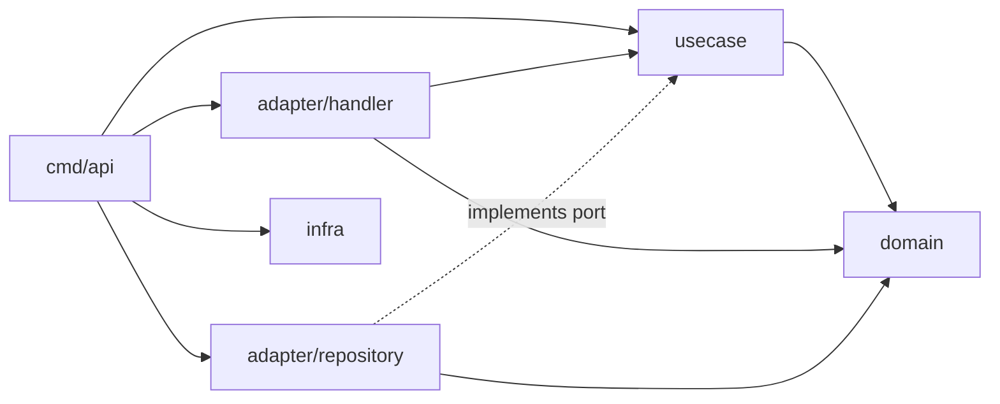

# アーキテクチャ

このドキュメントは「なぜこの構成なのか」を説明する。具体的な書き方は [coding-rules.md](coding-rules.md)、機能追加の手順は [adding-a-feature.md](adding-a-feature.md) を参照。

## 1. 前提：クリーンアーキテクチャの考え方

クリーンアーキテクチャは、アプリケーションを同心円状の層に分ける設計手法である。

- 中心に **ビジネスルール**（変わりにくく、価値の源泉）を置く
- 外側に **技術的な詳細**（DB・HTTP・フレームワーク。変わりやすい）を置く
- **依存は必ず外側から内側への一方向**（依存性のルール）

このルールを守ると、DB を替えても HTTP フレームワークを替えてもビジネスルールは無傷で済み、ビジネスルールは DB なしで単体テストできる。

内側が外側の機能（DB への保存など）を使いたい場合は、**内側に interface を定義し、外側がそれを実装する**。これを依存性逆転と呼ぶ。

## 2. このプロジェクトでの層の対応

| 層 | ディレクトリ | 責務 | 依存してよい先 |
|---|---|---|---|
| ① Entities | `internal/domain/` | エンティティ・値オブジェクト・ドメインエラー。不変条件を自分で守る | 標準ライブラリ、他の集約の domain |
| ② Use Cases | `internal/usecase/` | アプリ固有の処理手順。必要な外部依存を port(interface) として定義 | domain |
| ③ Interface Adapters | `internal/adapter/handler/` | HTTP ⇔ usecase の変換（入力側） | usecase, domain |
| | `internal/adapter/repository/` | usecase の port を DB で実装（出力側） | usecase, domain, DB ドライバ |
| ④ Frameworks & Drivers | `internal/infra/` | 設定・DB 接続・ロガーなど技術的な土台 | 外部ライブラリ |
| 組み立て | `cmd/api/` | 設定読込・DI 配線・サーバ起動 | すべて |



## 3. リクエストの流れ（POST /users の例）

1. [router.go](../internal/adapter/handler/router.go) がリクエストを `UserHandler.Create` に振り分ける
2. [handler/user.go](../internal/adapter/handler/user.go) が JSON を `usecase.CreateUserInput` に変換して usecase を呼ぶ
3. [usecase/user.go](../internal/usecase/user.go) の `UserUsecase.Create` が `user.NewEmail` / `user.New` でドメインオブジェクトを生成し、ルールを検証する
4. usecase は `TxManager` と `UserRepository`（[port.go](../internal/usecase/port.go) の interface）を通じて重複チェックと保存を行う
5. 実体は [repository/user.go](../internal/adapter/repository/user.go)。`cmd/api/main.go` で注入されている
6. usecase は `UserOutput` を返し、handler が JSON に変換してレスポンスする
7. エラーは [handler/error.go](../internal/adapter/handler/error.go) の対応表で HTTP ステータスに変換される

## 4. 設計判断（なぜこうしたか）

### 4-1. port(interface) は usecase に置く
Go には「interface は使う側で定義する」という慣習がある（[Go Code Review Comments](https://go.dev/wiki/CodeReviewComments#interfaces)）。Repository を使うのは usecase なので usecase に置く。これは依存性逆転の考え方とも一致する。同じ理由で、handler が使う usecase の interface も handler 側に定義している。

### 4-2. usecase は1パッケージにまとめる
`domain/user` と `usecase/user` のように同じ名前のパッケージが並ぶと、import のたびに別名が必要になる。そこで usecase は集約ごとのファイル（`user.go` など）で分け、パッケージは1つにする。肥大化したら 5章の構成へ移る。

### 4-3. domain には json / db タグを付けない
保存形式や表示形式は外側の関心事である。DTO（handler）と SQL のマッピング（repository）で詰め替える。

### 4-4. トランザクションは context で受け渡す
usecase は `TxManager.Do(ctx, fn)` で範囲を指定するだけで、`*sql.Tx` を知らない。repository は `conn(ctx, db)` でトランザクションの有無を判定する（[db.go](../internal/adapter/repository/db.go)）。

### 4-5. DI は手書きにする
依存関係を `main.go` で目で追えることを優先する。配線が数百行規模になったら wire / fx の導入を検討する。

### 4-6. 標準ライブラリ優先
ルーティングは gin（handler 層だけで使う）、ログは `log/slog`、DB は `database/sql` + pgx ドライバを使う。

### 4-7. 依存のルールは lint で強制する
レビューでは見落としが起きるため、[.golangci.yml](../.golangci.yml) の depguard で禁止 import を機械的に検出する。domain から usecase への import は循環 import になるため、コンパイラが検出する。import では表せないこのプロジェクト独自のルール（usecase は他の usecase を呼ばない、repository は `conn` を使う）は、forbidigo のパターンで検出する。lint の設定は `.golangci.yml` 1 つにまとめ、設定だけで表せないルール（interface は port.go に置く、など）はドキュメントで守る。

### 4-8. 集約をまたぐ処理は port から直接取る
usecase が他の usecase を呼ぶと、トランザクションの範囲や入力の検証が二重になり、呼び出しの連鎖で依存も追えなくなる。そこで、他の集約のデータが必要な usecase は、その集約の port（`UserRepository` など）を自分で持ち、直接取る。両方の集約にまたがる判断は domain に置く。手順は [adding-a-feature.md 5 章](adding-a-feature.md#5-他の集約のデータを使う)。

## 5. 規模が大きくなったら

集約が 5〜10 個を超えて `usecase/` が肥大化したら、機能ごとに分ける構成（モジュラーモノリス）へ移る。

```
internal/
├── user/{domain,usecase,adapter}/
├── order/{domain,usecase,adapter}/
└── platform/   # 旧 infra。全機能で共有する土台
```

分けた後も、機能同士で usecase は呼ばない（4-8）。相手の機能のデータが必要なら、自分の usecase の port に必要なメソッドだけを定義し、相手の機能の adapter がそれを実装する。層の境界を守っていれば、移行はディレクトリの移動で済む。

## 参考
- [Organizing a Go module（Go 公式）](https://go.dev/doc/modules/layout)
- [The Clean Architecture（Robert C. Martin）](https://blog.cleancoder.com/uncle-bob/2012/08/13/the-clean-architecture.html)
- [bxcodec/go-clean-arch](https://github.com/bxcodec/go-clean-arch)
- [ThreeDotsLabs/wild-workouts-go-ddd-example](https://github.com/ThreeDotsLabs/wild-workouts-go-ddd-example)
