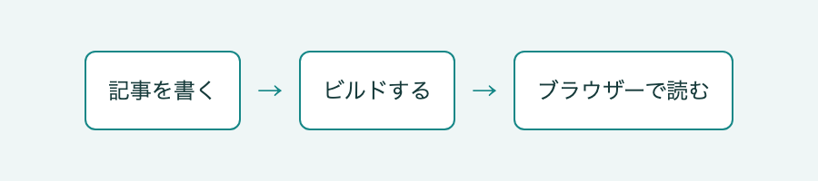

# 記事を書く

記事はdocs/のMarkdownファイルとして管理します。guide/に記事を追加すると、自動サイドバーに表示され、次のビルドで検索対象にもなります。

## 見出しとコード

見出しは記事の区切りになり、右の目次から移動できます。コードには言語を指定すると、その言語に合わせて色が付きます。

```ts
const site = {title: 'チームの手順書'};
console.log(site.title);
```

## 公開までの流れ

記事を書いたら、リンクと設定を確認するためにビルドします。成功した出力をブラウザーで読み、読みやすさを確認します。



## 関連する記事へつなぐ

[サイトを設定する](./configuration.md)へ相対リンクで移動できます。[見出しとコード](#見出しとコード)のように同じ記事内の見出しも参照できます。存在しない記事へのリンクはビルド時に検出します。
